# Manual Técnico del Sistema — Plataforma Ch'asca (Zero Trust Document Management & PAdES-LTV Digital Signature)

**Versión del Documento:** `1.0.0`  
**Fecha de Emisión:** 2026-11-24  
**Audiencia:** Equipo de TI Externo, Arquitectura, DevOps / SRE, Ciberseguridad y Mantenimiento  
**Alcance del Sistema:** Ecosistema integrado compuesto por tres repositorios acoplados por contrato:
1. **Backend API (`Chaska`)**: Monolito Modular DDD en Spring Boot `4.1.1` / Java 21 LTS (`c:\Users\ASUS\dev\Chaska`).
2. **Agente Hardware Local (`Killa` / `KILLAgent`)**: Daemon de escritorio Windows en Java 21 LTS `v1.0.1` (`c:\Users\ASUS\dev\Killa`).
3. **Frontend SPA (`chaska-webapp`)**: Aplicación web React `19.3.1` / TypeScript `6.0.3` / Vite `8.3.6` (`c:\Users\ASUS\dev\chaska-webapp`).

---

## Tabla de Contenidos

1. [Arquitectura y Diagramas UML](#1-arquitectura-y-diagramas-uml)
2. [Estándares de Codificación y Buenas Prácticas](#2-estándares-de-codificación-y-buenas-prácticas)
3. [Código Fuente Crítico Comentado](#3-código-fuente-crítico-comentado)
4. [Documentación de APIs y Bibliotecas Internas](#4-documentación-de-apis-y-bibliotecas-internas)
5. [Funcionalidades Detalladas y Flujo de Usuario](#5-funcionalidades-detalladas-y-flujo-de-usuario)
6. [Arquitectura de Despliegue e Infraestructura](#6-arquitectura-de-despliegue-e-infraestructura)
7. [Plan de Mantenimiento (Basado en ISO/IEC 14764)](#7-plan-de-mantenimiento-basado-en-isoiec-14764)

---

## 1. Arquitectura y Diagramas UML

### 1.1 Visión General e Invariantes Arquitectónicos

**Ch'asca** resuelve la gestión documental inmutable y firma digital avanzada con validez probatoria a largo plazo (**PAdES-LTV**) para organizaciones sin fines de lucro (ONGs) e instituciones reguladas en el Perú, integrando el **DNI Electrónico Peruano (DNIe 2.0 / 3.0)** y cumpliendo con:

- **Zero Trust Architecture (NIST SP 800-207):** Ningún usuario ni petición recibe confianza implícita por red. Toda operación protegida exige un JWT stateless de corta duración (1800 s / 30 min) vinculado a una sesión física activa de tarjeta inteligente (`HardwareTokenSession`), validación RBAC por permisos atómicos (`SystemPermission`), evaluación contextual ABAC (`ZeroTrustPolicyEvaluator` y `DocumentAccessGuard`) y reautenticación de PIN en caliente (*Step-Up PIN*, HTTP `428`).
- **Custodia Documental Inmutable (ISO 15489-1 e ISO 23081):** Separación estricta entre el contenedor administrativo (`RecordDocument`) y sus versiones físicas inmutables (`DocumentVersion`), persistidas con **Object Locking WORM** en MinIO (`COMPLIANCE` / `GOVERNANCE`), versionado S3, *Legal Hold* y metadatos archivísticos ISO 23081.
- **Trazabilidad Forense No Repudiable:** Bitácora *append-only* (`ImmutableAuditLog`) procesada de forma asíncrona mediante cola en memoria (`JvmAuditQueueWorker`) con encadenamiento secuencial `HMAC-SHA256` (`RowSignatureEngine`) y ancla externa verificable (`latest-audit-anchor.json`).
- **Privacidad de Datos (Ley Peruana N.º 29733):** Registro de consentimientos informados (`DataPrivacyConsent`) y gestión del ciclo de vida de solicitudes ARCO (`ArcoRequest`).

#### Cuatro Invariantes Transversales del Sistema

| Invariante | Regla Estricta | Mecanismo de Cumplimiento |
| :--- | :--- | :--- |
| **1. Air-Gapped Local Hardware** | El backend `Chaska` **NUNCA** se conecta a `KILLAgent` (`127.0.0.1:3000`). | `chaska-webapp` actúa como puente exclusivo en el navegador entre `KILLAgent` (loopback) y `/api/v1/**` (HTTPS). |
| **2. Aislamiento Total del PIN** | El PIN del DNIe **NUNCA** entra al DOM del navegador ni viaja en tramas HTTP/WebSocket. | Se captura únicamente en `AntiKeyloggerKeypadDialog` (`Swing`/`JNA`), dentro de `PinBuffer` (`char[]` limpiado con `\0`). |
| **3. Kill-Switch Hardware en Tiempo Real** | Retirar físicamente el DNIe bloquea/invalida la sesión de inmediato. | `WinSCardReaderProbe` emite `CARD_REMOVED`; `KillAgentClient` dispara `HardwareLockOverlay` (60s) y revoca la sesión en backend. |
| **4. Sincronización de Contratos y ACL** | Los 6 Bounded Contexts de `Chaska` no comparten repositorios ni entidades internas. | Comunicación inter-contexto únicamente vía `*ContextFacade` (`interfaces.acl`) y `*ExternalService` (`outboundservices.acl`). |

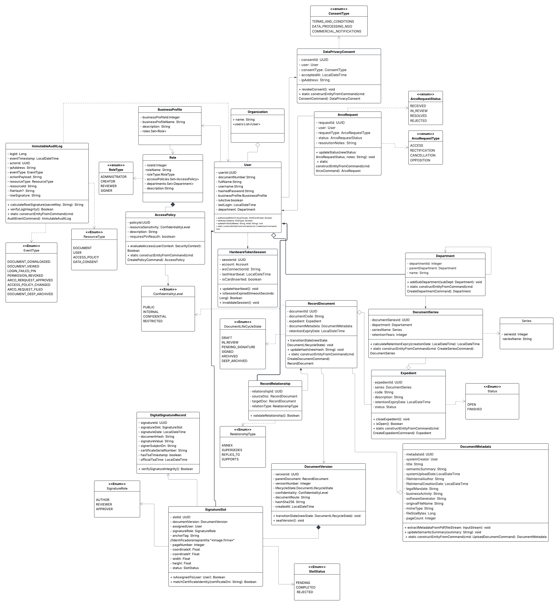

---

### 1.2 Diagramas de Clases / Entidades (Mermaid.js)

#### 1.2.1 Modelo de Dominio y Fachadas ACL de Backend (`Chaska` — 6 Bounded Contexts)

```mermaid
classDiagram
    direction LR

    namespace iam {
        class Account {
            +UUID accountId
            +String username
            +String documentNumber
            +String hashedPassword
            +Boolean isActive
            +LocalDateTime lastLogin
        }
        class BusinessProfile {
            +Integer businessProfileId
            +String businessProfileName
            +String description
        }
        class Role {
            +Long roleId
            +String roleName
            +RoleType roleType
            +Set~SystemPermission~ permissions
        }
        class AccessPolicy {
            +UUID policyId
            +ConfidentialityLevel resourceSensitivity
            +Boolean requiresPinReauth
            +evaluateAccess(SecurityContext) boolean
        }
        class AuthenticationChallenge {
            +UUID challengeId
            +UUID accountId
            +String nonce
            +LocalDateTime expiresAt
            +boolean consumed
        }
        class HardwareTokenSession {
            +UUID sessionId
            +String wsConnectionId
            +String readerName
            +LocalDateTime lastHeartbeat
            +Boolean isCardInserted
        }
        class AccountOnboardingInvitation {
            +UUID invitationId
            +String token
            +String documentNumber
            +LocalDateTime expiresAt
            +LocalDateTime consumedAt
        }
        class DataPrivacyConsent {
            +UUID consentId
            +ConsentType consentType
            +LocalDateTime acceptedAt
            +Boolean isRevoked
        }
        class ArcoRequest {
            +UUID requestId
            +ArcoRequestType requestType
            +ArcoRequestStatus status
        }
        class IamContextFacade {
            +fetchCurrentAuthorizationProfile() UserAuthorizationProfileResource
            +isPinReauthenticated() boolean
        }
    }

    namespace users {
        class Organization {
            +UUID organizationId
            +String name
        }
        class Department {
            +Integer departmentId
            +String name
        }
        class User {
            +UUID userId
            +String firstNames
            +String lastNames
            +String email
            +String age
            +String gender
        }
        class UsersContextFacade {
            +createUserForAccount(...) UUID
            +fetchUserByAccountId(UUID) Optional~User~
        }
    }

    namespace documentmanagement {
        class Series {
            +Integer seriesId
            +String name
        }
        class DocumentSeries {
            +UUID documentSeriesId
            +String seriesCode
            +Integer retentionYears
            +String documentaryValue
        }
        class Expedient {
            +UUID expedientId
            +String code
            +String title
            +ExpedientStatus status
            +ConfidentialityLevel confidentialityLevel
            +LocalDateTime retentionExpiryDate
        }
        class RecordDocument {
            +UUID documentId
            +String documentCode
            +LocalDateTime retentionExpiryDate
        }
        class DocumentMetadata {
            +UUID metadataId
            +String title
            +String originalFileName
            +String mimeType
            +Long fileSizeBytes
            +Integer pageCount
        }
        class DocumentVersion {
            +UUID versionId
            +Integer versionNumber
            +DocumentLifecycleState lifecycleState
            +ConfidentialityLevel confidentiality
            +WormRetentionMode retentionMode
            +String hashSha256
            +String storageBucket
            +String documentRoute
            +String storageVersionId
            +Boolean legalHoldActive
        }
        class RecordRelationship {
            +UUID relationshipId
            +RelationshipType relationType
        }
        class DocumentManagementContextFacade {
            +fetchAuthorizedVersionForVerification(UUID) DocumentVersionVerificationSnapshot
            +storeSignedVersion(...) StoredObjectReceipt
        }
    }

    namespace signatureengine {
        class SignatureSlot {
            +UUID slotId
            +SignatureRole signatureRole
            +SlotStatus status
            +String anchorTag
            +Integer pageNumber
            +String targetDni
        }
        class DigitalSignatureRecord {
            +UUID signatureId
            +String signedDocumentHash
            +String signatureCryptogram
            +String signerSubjectDn
            +String certificateSerialNumber
            +Boolean hasTsaTimestamp
            +LocalDateTime officialTsaTime
        }
        class SignatureEngineContextFacade {
            +scanAndRegisterSlots(UUID) void
            +hasCompletedSignatures(UUID) boolean
        }
    }

    namespace audittrail {
        class AuditEventType {
            +Integer eventTypeId
            +String code
            +String category
            +String severity
            +Boolean triggersImmediateAlert
        }
        class ImmutableAuditLog {
            +Long logId
            +UUID eventUuid
            +LocalDateTime eventTimestamp
            +UUID actorId
            +ResourceType resourceType
            +String previousRowSignature
            +String rowSignature
            +verifyLogIntegrity(String) boolean
        }
        class AuditTrailContextFacade {
            +enqueueForensicEvent(...) void
        }
    }

    Account "0..*" --> "1" BusinessProfile : "business_profile_id"
    BusinessProfile "0..*" --> "0..1" Department : "department_id"
    BusinessProfile "0..*" --> "0..*" Role : "business_profile_roles"
    Role "1" *-- "0..*" AccessPolicy : "accessPolicies"
    Role "0..*" --> "0..*" Department : "role_departments"
    HardwareTokenSession "0..*" --> "1" Account : "account_id"
    AccountOnboardingInvitation "0..*" --> "1" BusinessProfile : "business_profile_id"
    User "1" --> "1" Account : "account_id"
    User "0..*" --> "1" Department : "primary department_id"
    User "0..*" --> "0..*" Department : "secondary departments"
    User "0..*" --> "0..1" Organization : "organization_id"
    Department "0..*" --> "0..1" Department : "parentDepartment"
    DataPrivacyConsent "0..*" --> "1" User : "user_id"
    ArcoRequest "0..*" --> "1" User : "user_id"

    DocumentSeries "0..*" --> "1" Department : "department_id"
    DocumentSeries "0..*" --> "1" Series : "series_id"
    Expedient "0..*" --> "1" DocumentSeries : "document_series_id"
    RecordDocument "0..*" --> "1" Expedient : "expedient_id"
    RecordDocument "1" *-- "1" DocumentMetadata : "metadata_id"
    RecordDocument "1" *-- "1..*" DocumentVersion : "versions"
    DocumentMetadata "0..*" --> "1" User : "system_creator_id"
    RecordRelationship "0..*" --> "1" RecordDocument : "sourceDoc / targetDoc"

    SignatureSlot "0..*" --> "1" DocumentVersion : "version_id"
    SignatureSlot "0..*" --> "0..1" User : "assigned_user_id"
    DigitalSignatureRecord "0..1" --> "1" SignatureSlot : "slot_id"
    ImmutableAuditLog "0..*" --> "1" AuditEventType : "event_type_id"
```

#### 1.2.2 Arquitectura de Clases del Agente Hardware (`KILLAgent` v1.0.1)

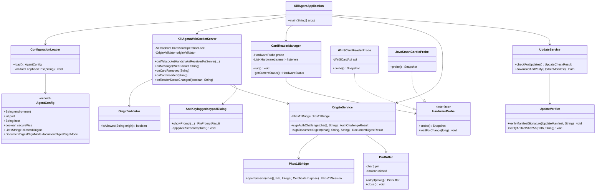

#### 1.2.3 Arquitectura de Módulos, Providers y Servicios del Frontend (`chaska-webapp`)

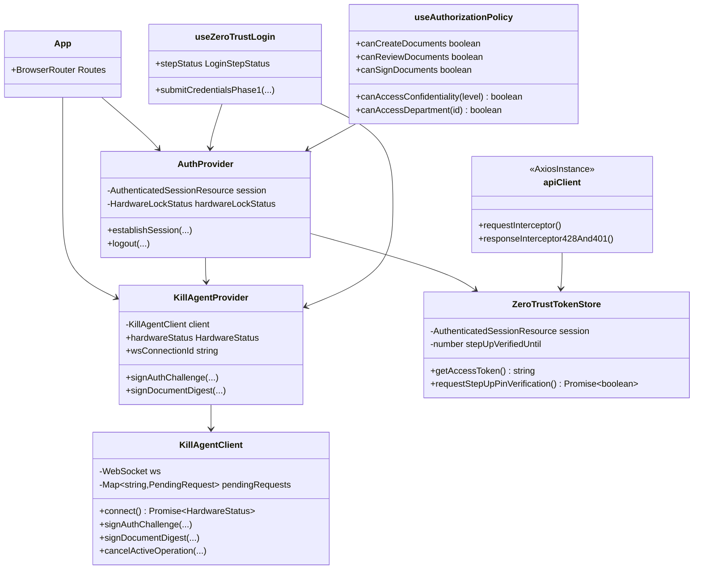

---

### 1.3 Diagramas de Secuencia (Mermaid.js)

#### 1.3.1 Login Zero Trust en 2 Fases, Sesión Hardware y Kill-Switch `CARD_REMOVED`

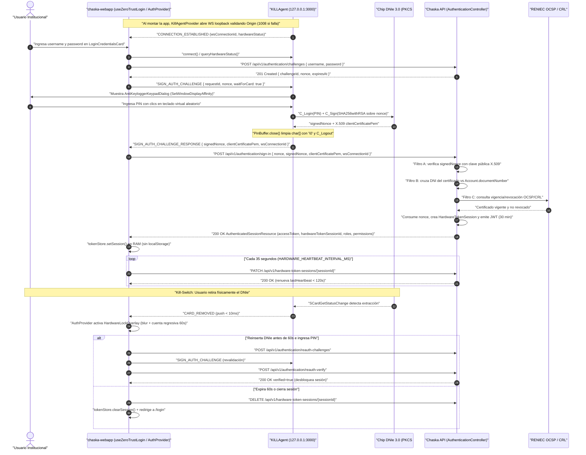

#### 1.3.2 Carga Custodiada WORM en MinIO y Firma Digital PAdES-LTV con TSA RFC 3161

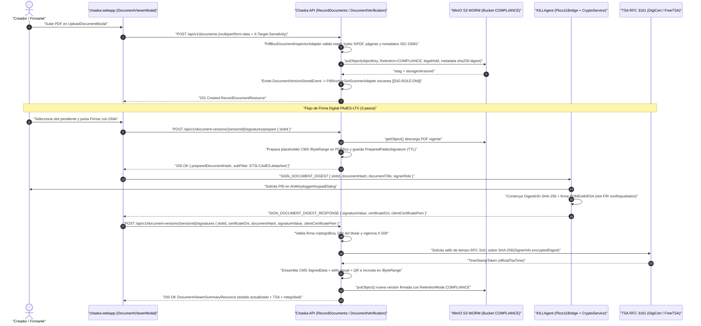

#### 1.3.3 Intercepción ABAC y Step-Up PIN en Caliente (`HTTP 428 Precondition Required`)

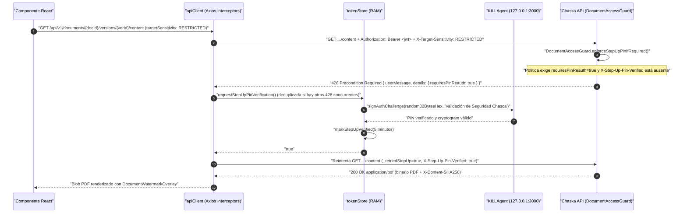

---

### 1.4 Diagramas de Actividad (Mermaid.js)

#### 1.4.1 Máquina de Estados del Ciclo de Vida Documental (`DocumentLifecycleState`)

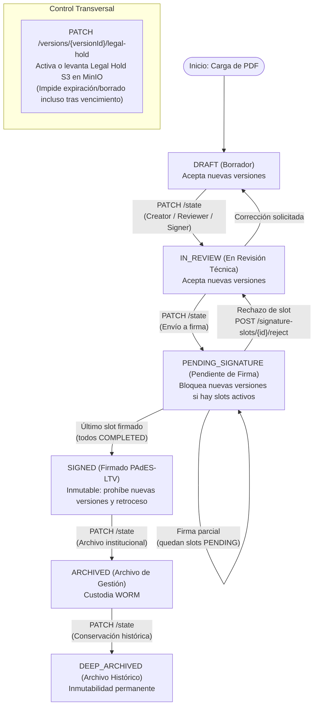

#### 1.4.2 Pipeline de Evaluación Híbrida Zero Trust (JWT + RBAC + ABAC)

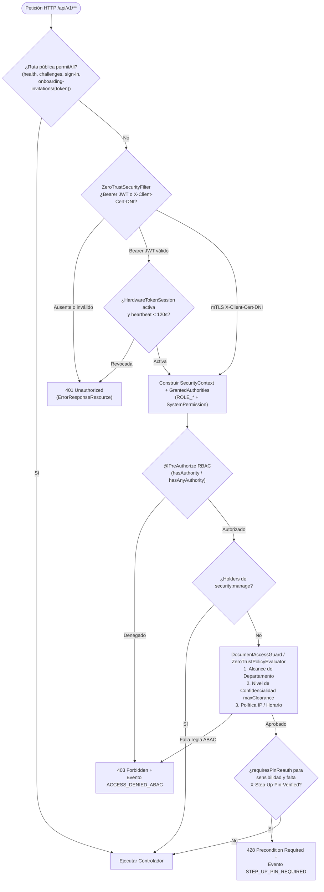

#### 1.4.3 Pipeline Asíncrono de Auditoría Inmutable y Verificación Forense (`HMAC-SHA256`)

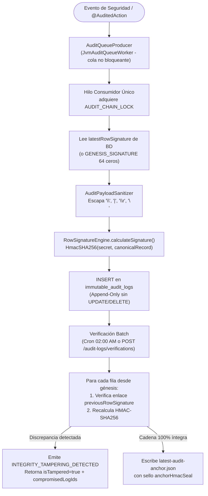

---

## 2. Estándares de Codificación y Buenas Prácticas

### 2.1 Stack Tecnológico Verificado

| Capa | Tecnología / Biblioteca | Versión Exacta | Propósito en el Sistema |
| :--- | :--- | :--- | :--- |
| **Backend (`Chaska`)** | Java LTS | `21` | Runtime principal del monolito modular |
| | Spring Boot (`spring-boot-starter-parent`) | `4.1.1` | WebMVC, Data JPA, Security, Validation |
| | MySQL Connector/J | Gestionado por Boot | Persistencia relacional transaccional (`chaskaDB`) |
| | MinIO Java SDK (`io.minio:minio`) | `9.0.4` | Custodia S3 WORM Object Lock y Legal Hold |
| | Apache PDFBox (`org.apache.pdfbox:pdfbox`) | `3.0.8` | Inspección, `/ByteRange`, escaneo de anclas y estampado |
| | Bouncy Castle (`bcpkix-jdk18on`) | `1.86` | X.509, CMS/PAdES, OCSP/CRL RENIEC, RFC 3161 |
| | JJWT (`io.jsonwebtoken:jjwt-*`) | `0.12.6` | Tokens Bearer HMAC-SHA256 stateless |
| | SpringDoc OpenAPI (`springdoc-openapi-starter-webmvc-ui`) | `2.8.5` | Especificación OpenAPI 3 y Swagger UI |
| | Pluralize (`io.github.encryptorcode:pluralize`) | `1.0.0` | Pluralización física de tablas MySQL |
| **Agente (`KILLAgent`)** | Java LTS | `21` | Daemon de escritorio Windows (`v1.0.1`) |
| | Java-WebSocket (`org.java-websocket`) | `1.5.7` | Servidor WS/WSS loopback (`127.0.0.1:3000`) |
| | Jackson (`jackson-databind` + `jsr310`) | `2.17.2` | Serialización JSON del protocolo WebSocket |
| | FlatLaf + JSVG | `3.5.1` / `1.4.0` | Tema Windows 11 y renderizado SVG nativo |
| | JNA + JNA-Platform | `5.14.0` | `WinSCard.dll`, `SetWindowDisplayAffinity`, Registro HKCU |
| | Bouncy Castle (`bcprov` + `bcpkix`) | `1.78.1` | PKCS#12 TLS loopback y parsing X.509 |
| | `dotenv-java` / `slf4j-simple` | `3.0.2` / `2.0.13` | Carga jerárquica de config y logs rotativos |
| **Frontend (`chaska-webapp`)** | React / React DOM | `19.3.1` | UI declarativa con React Compiler |
| | TypeScript | `~6.0.3` | Tipado estricto (`noUnusedLocals`, `erasableSyntaxOnly`) |
| | Vite + `@vitejs/plugin-react` | `8.3.6` / `6.1.2` | Empaquetado SPA y proxy `/api` en desarrollo |
| | Tailwind CSS (`@tailwindcss/vite`) | `4.3.4` | Sistema de diseño utility-first |
| | TanStack React Query | `5.106.1` | Caché, invalidación y estado asíncrono |
| | Axios + React Router DOM | `1.21.0` / `7.18.5` | Cliente HTTP Zero Trust y enrutamiento SPA |
| | ESLint + `typescript-eslint` | `10.14.0` / `8.72.1` | Análisis estático, hooks y React Refresh |

---

### 2.2 Estructura de Carpetas y Arquitectura por Repositorio

#### A. Backend (`Chaska` — Monolito Modular DDD + CQRS + ACL)
Cada Bounded Context bajo `org.com.platform.chaska.{context}` (`iam`, `users`, `documentmanagement`, `signatureengine`, `audittrail`, `shared`) respeta estrictamente cuatro capas:
```text
org.com.platform.chaska.{context}
├── domain
│   ├── model/{aggregates,entities,valueobjects,commands,queries}
│   ├── services/{Aggregate}CommandService.java | {Aggregate}QueryService.java
│   └── repositories/
├── application/internal
│   ├── commandservices/{aggregate}/{Aggregate}CommandServiceImpl.java
│   ├── queryservices/{aggregate}/{Aggregate}QueryServiceImpl.java
│   └── outboundservices/acl/{External}ExternalService.java
├── infrastructure/{persistence/jpa,adapters,seeding,security,storage,tsa,pki}
└── interfaces
    ├── rest/{controllers,resources,transform}
    └── acl/{entity}/{Context}ContextFacade.java
```
- **Regla ACL:** Queda prohibido importar entidades, repositorios o implementaciones `application` de otro Bounded Context. Toda comunicación inter-contexto pasa por `*ContextFacade` (upstream) y `*ExternalService` (downstream).
- **Segregación CQRS:** Los métodos de escritura reciben Java `record *Command` (`@Transactional`); los de consulta reciben Java `record *Query` (`@Transactional(readOnly = true)`).

#### B. Agente Hardware (`Killa` — Subsistema por Responsabilidad)
```text
pe.ong.chasca.killagent
├── config/             # AgentConfig (record), ConfigurationLoader, AppPaths, AgentVersion
├── crypto/             # CryptoService, PinBuffer, RsaDigestInfoHelper, CertificatePurpose
├── hardware/           # CardReaderManager, HardwareProbe, JavaSmartCardIoProbe
│   ├── pkcs11/         # Pkcs11Bridge (SunPKCS11 sin doble descuento de PIN)
│   └── winscard/       # WinSCardApi (JNA), WinSCardReaderProbe
├── security/           # OriginValidator, LoopbackSslContextFactory, SingleInstanceLock
├── server/ (+ dto/)    # KillAgentWebSocketServer y DTOs JSON del protocolo
├── system/             # LoggingBootstrap, WindowsStartupManager
├── ui/                 # AntiKeyloggerKeypadDialog, WaitForCardDialog, SystemTrayManager, DiagnosticsDialog
└── update/             # UpdateService, UpdateVerifier (Ed25519 + SHA-256), UpdateInstaller
```

#### C. Frontend (`chaska-webapp` — Arquitectura Feature-Based)
```text
src/
├── config/env.ts       # Variables de entorno y defaults seguros
├── core/               # Infraestructura transversal: api/ (apiClient, ApiError, queryClient),
│                       # auth/ (AuthProvider, tokenStore, policyCatalog, AuthorizationPolicyModal),
│                       # hardware/ (KillAgentClient, KillAgentProvider, killAgent.types)
├── features/           # Módulos de negocio autocontenidos:
│   ├── iam/            # Login 2-Fases, Dashboard, HardwareLockOverlay, authService
│   ├── documents/      # Upload, Preview, Viewer PKI, Watermark, recordDocumentService
│   └── organization/   # Departamentos, Series, Expedientes, Personal, Onboarding /registro/:token
└── shared/             # ProtectedRoute, AppShell, AppSidebar, AppToolbar, ShellProvider
```

---

### 2.3 Nomenclatura y Convenciones de Base de Datos

- **Java:** Clases en `PascalCase`; comandos/consultas como Java `record` inmutables (`CreateExpedientCommand`, `GetAllUsersQuery`); DTOs REST terminados en `Resource` (`RecordDocumentResource`); transformadores estáticos en `transform/*Assembler.java`.
- **TypeScript / React:** Componentes y páginas en `PascalCase.tsx`; hooks con prefijo `use` (`useZeroTrustLogin.ts`); servicios y utilidades en `camelCase.ts`; tipos compartidos en `*.types.ts`.
- **Persistencia MySQL (`SnakeCaseWithPluralizedTablePhysicalNamingStrategy`):**
  - Toda tabla física se traduce automáticamente a `snake_case` pluralizado (ej. `RecordDocument` $\rightarrow$ `record_documents`, `ImmutableAuditLog` $\rightarrow$ `immutable_audit_logs`, `BusinessProfile` $\rightarrow$ `business_profiles`).
  - Todas las columnas se normalizan a `snake_case`.
  - **UUID Legibles:** `spring.jpa.properties.hibernate.type.preferred_uuid_jdbc_type=CHAR` mapea todos los `UUID` a `CHAR(36)` legible en MySQL en lugar de `BINARY(16)`.

---

### 2.4 Formateo, Linters y Reglas de Compilación

- **Backend & Agent:** Java 21 (`<release>21</release>`), codificación `UTF-8`, verificación obligatoria con `.\mvnw.cmd test` (`Chaska`: 91 pruebas unitarias/integración) y `mvn test` (`Killa`: 51 pruebas JUnit 5).
- **Frontend (`tsconfig.app.json` + `eslint.config.js`):**
  - `erasableSyntaxOnly: true` (prohíbe sintaxis TypeScript no borrable como `enum` tradicionales o propiedades de parámetro en constructor; usar `type` unions).
  - `verbatimModuleSyntax: true` (exige `import type` explícito para tipos).
  - `noUnusedLocals: true` y `noUnusedParameters: true`.
  - `eslint-plugin-react-refresh`: archivos `.tsx` de componentes no deben exportar constantes/funciones utilitarias mezcladas (deben vivir en `*Def.ts` o `utils/`).
  - Comando obligatorio de validación: `npm run build && npm run lint`.

---

### 2.5 Manejo Estandarizado de Errores y Documentación Interna

1. **Cadena de Excepciones del Backend (`GlobalExceptionHandler`):**
   - `DomainException` (reglas de negocio puras: `ZeroTrustAuthenticationException` $\rightarrow$ `401`, `AccessPolicyDeniedException` $\rightarrow$ `403`, `PinReauthenticationRequiredException` $\rightarrow$ `428`, `DocumentAlreadySignedException` / `InvalidEntityStateException` $\rightarrow$ `409`).
   - `ApplicationException` (casos de uso: `ValidationException` $\rightarrow$ `400`, `UnauthorizedApplicationException` $\rightarrow$ `401`, `ForbiddenApplicationException` $\rightarrow$ `403`, `ResourceNotFoundException` $\rightarrow$ `404`, `ResourceConflictException` $\rightarrow$ `409`, `ServiceUnavailableException` $\rightarrow$ `503`).
   - **Regla de Oro de Seguridad:** Cada excepción separa `systemMessage` (inglés, solo para logs internos del servidor) de `userMessage` (español seguro, enviado en `ErrorResponseResource`). Jamás se filtran stack traces ni mensajes internos al cliente HTTP.
2. **Estándar de Documentación Interna (Aplicado durante la Auditoría):**
   - **Backend (`Chaska`) y Agent (`Killa`):** Javadoc (`/** ... */`) en inglés técnico formal sobre clases, interfaces de servicio, DTOs WebSocket, controladores y métodos públicos, especificando invariantes Zero Trust, `@param` y comportamiento ante errores.
   - **Frontend (`chaska-webapp`):** Bloques TSDoc/JSDoc (`/** ... */`) en español técnico formal en módulos `core/`, `features/` y `shared/`, documentando props, flujo de estado, dependencias de permisos y propósito fallback de `documentManagementMockService.ts`.

---

## 3. Código Fuente Crítico Comentado

> Todos los fragmentos presentados a continuación fueron auditados, documentados con Javadoc/TSDoc directamente en el repositorio y verificados compilando y pasando las pruebas automatizadas.

### 3.1 Seguridad Zero Trust y Motor ABAC (`Chaska`)

#### `ZeroTrustSecurityFilter.java`
**Ubicación:** `c:\Users\ASUS\dev\Chaska\src\main\java\org\com\platform\chaska\iam\infrastructure\authorization\sfs\filters\ZeroTrustSecurityFilter.java` (L40–199)

```java
/**
 * Dual-Mode Zero Trust Security Filter (NIST SP 800-207):
 * <ol>
 *   <li><b>Primary Mode (Stateless Bearer JWT):</b> Validates JWT access tokens issued at login,
 *       verifies the bound {@link HardwareTokenSession} has not been revoked and remains within the
 *       120-second hardware heartbeat timeout, and rejects revoked/expired tokens with HTTP 401.</li>
 *   <li><b>Secondary / Perimeter Mode (mTLS Header):</b> Supports Cloudflare Access perimeter
 *       {@code X-Client-Cert-DNI} authentication when direct mTLS termination is active.</li>
 *   <li><b>Context &amp; Correlation Propagation:</b> Propagates {@code X-Correlation-Id} into SLF4J
 *       MDC and response headers, reads {@code X-Target-Sensitivity} and
 *       {@code X-Step-Up-Pin-Verified}, resolves the client IP, and populates Spring SecurityContext
 *       with both {@code ROLE_*} and atomic {@link SystemPermission} authorities alongside a
 *       {@link SecurityContext} details record.</li>
 * </ol>
 */
// Fragmento representativo (L130-L190): Validación stateless + sesión hardware viva
if (authHeader != null && authHeader.startsWith(PREFIX_BEARER)) {
    String token = authHeader.substring(PREFIX_BEARER.length()).trim();
    if (jwtTokenProvider.validateToken(token)) {
        Claims claims = jwtTokenProvider.extractClaims(token);
        UUID accountId = jwtTokenProvider.extractAccountId(claims);
        UUID userId = jwtTokenProvider.extractUserId(claims);
        String username = jwtTokenProvider.extractUsername(claims);
        Integer departmentId = jwtTokenProvider.extractDepartmentId(claims);
        Set<RoleType> roles = jwtTokenProvider.extractRoles(claims);
        Set<SystemPermission> permissions = jwtTokenProvider.extractPermissions(claims);
        UUID hwSessionId = jwtTokenProvider.extractHardwareSessionId(claims);

        boolean isHardwareCardPresent = false;
        if (hwSessionId != null) {
            Optional<HardwareTokenSession> hwSessionOpt = hardwareTokenSessionRepository.findById(hwSessionId);
            if (hwSessionOpt.isPresent()) {
                HardwareTokenSession hwSession = hwSessionOpt.get();
                // Si el usuario retiró el DNIe y el Kill-Switch revocó la sesión, el JWT queda invalidado aunque no haya expirado
                if (!Boolean.TRUE.equals(hwSession.getIsCardInserted())) {
                    writeErrorResponse(
                            response,
                            HttpStatus.UNAUTHORIZED,
                            "JWT hardware session has been revoked or logged out",
                            "Su sesión ha sido cerrada o revocada. Por favor, inicie sesión nuevamente.",
                            "\"reason\":\"SESSION_REVOKED\""
                    );
                    return;
                }
                isHardwareCardPresent = !hwSession.isSessionExpired(HARDWARE_SESSION_TIMEOUT_SECONDS);
            }
        }
        // Inyecta el contexto ABAC (sensibilidad objetivo, Step-Up PIN, IP real CF-Connecting-IP) en SecurityContextHolder
        SecurityContext zeroTrustContext = new SecurityContext(
                accountId, userId, roles, permissions, departmentId,
                resolveTargetSensitivity(request.getHeader(HEADER_TARGET_SENSITIVITY)),
                Boolean.parseBoolean(request.getHeader(HEADER_PIN_VERIFIED)),
                isHardwareCardPresent, resolveClientIp(request), LocalDateTime.now()
        );
        UsernamePasswordAuthenticationToken authentication = new UsernamePasswordAuthenticationToken(
                username, null, buildGrantedAuthorities(roles, permissions)
        );
        authentication.setDetails(zeroTrustContext);
        SecurityContextHolder.getContext().setAuthentication(authentication);
        filterChain.doFilter(request, response);
        return;
    }
}
```
- **Decisión de Diseño:** Aunque el JWT es stateless (30 min), cada petición valida en vivo el flag `isCardInserted` y la ventana de heartbeat de `120` segundos (`HARDWARE_SESSION_TIMEOUT_SECONDS`) de `HardwareTokenSession`. Esto permite que el *Kill-Switch* de `KILLAgent` revoque de inmediato tokens aún vigentes por reloj.

#### `ZeroTrustPolicyEvaluator.java` y `DocumentAccessGuard.java`
**Ubicación:** `c:\Users\ASUS\dev\Chaska\src\main\java\org\com\platform\chaska\iam\infrastructure\authorization\evaluators\ZeroTrustPolicyEvaluator.java` (L71–95) y `c:\Users\ASUS\dev\Chaska\src\main\java\org\com\platform\chaska\documentmanagement\application\internal\security\DocumentAccessGuard.java` (L122–165)

```java
// ZeroTrustPolicyEvaluator.java (L79-L85): Segregación de Funciones NIST
if (details instanceof SecurityContext zeroTrustContext) {
    // Únicamente los administradores de seguridad (security:manage) poseen clearance incondicional;
    // roles operativos como HR Manager o HR Specialist siguen sujetos a evaluación ABAC por departamento y sensibilidad.
    if (zeroTrustContext.hasFullSecurityClearance()) {
        return true;
    }
}

// DocumentAccessGuard.java (L122-L165): Defensa en profundidad por documento + Step-Up PIN (HTTP 428)
public void enforceDocumentAccess(RecordDocument document, DocumentVersion version, boolean checkStepUpPin) {
    if (document == null) {
        return;
    }
    Integer deptId = extractDepartmentId(document);
    enforceDepartmentAccess(deptId, "No cuenta con autorización en el departamento propietario de este documento.");

    ConfidentialityLevel sensitivity = version != null && version.getConfidentiality() != null
            ? version.getConfidentiality()
            : resolveExpedientSensitivity(document.getExpedient());
    enforceSensitivityAccess(sensitivity, null);

    if (checkStepUpPin) {
        enforceStepUpPinIfRequired(sensitivity, false);
    }
}

public void enforceStepUpPinIfRequired(ConfidentialityLevel sensitivity, boolean forcePinVerification) {
    UserAuthorizationProfileResource authProfile = fetchAuthProfileOrNull();
    boolean requiredByPolicy = authProfile != null
            && sensitivity != null
            && authProfile.pinReauthRequiredLevels() != null
            && authProfile.pinReauthRequiredLevels().contains(sensitivity)
            && !authProfile.hasFullSecurityClearance();

    if ((forcePinVerification || requiredByPolicy) && !iamExternalService.isPinReauthenticated()) {
        throw new PinReauthenticationRequiredException(
                "Step-Up PIN verification required for sensitivity level " + sensitivity,
                "Esta operación requiere verificar nuevamente su PIN físico del DNIe 3.0.",
                Map.of(
                        "requiresPinReauth", true,
                        "requiredSensitivity", sensitivity != null ? sensitivity.name() : ConfidentialityLevel.RESTRICTED.name()
                )
        );
    }
}
```
- **Explicación Arquitectónica:** `DocumentAccessGuard` aplica evaluación imperativa sobre la entidad cargada de BD (no solo cabeceras del cliente), evitando ataques de escalación donde un cliente envíe `X-Target-Sensitivity: PUBLIC` al pedir un documento `RESTRICTED`.

---

### 3.2 Custodia Inmutable MinIO WORM (`Chaska`)

**Ubicación:** `c:\Users\ASUS\dev\Chaska\src\main\java\org\com\platform\chaska\documentmanagement\infrastructure\storage\minio\MinioS3DocumentStorageAdapter.java` (L97–154 y L311–359)

```java
/**
 * Persists a PDF binary as a new immutable versioned object in MinIO S3 with WORM Object Lock
 * retention ({@code GOVERNANCE} or {@code COMPLIANCE}), optional Legal Hold, and ISO 23081
 * custom user metadata ({@code sha256-digest}, {@code document-code}, {@code expedient-code}).
 */
@Override
public StoredObjectReceipt storeImmutableObject(StoreObjectCommand command) {
    try {
        ensureBucketWithObjectLock();
        String bucket = properties.getBucket();
        String objectKey = StorageObjectKeyBuilder.buildImmutableObjectKey(command);
        WormRetentionMode targetMode = command.retentionMode() != null
                ? command.retentionMode()
                : properties.getDefaultRetentionMode();
        RetentionMode minioMode = toMinioRetentionMode(targetMode);
        ZonedDateTime retainUntilUtc = StorageObjectKeyBuilder.resolveFutureRetainUntilUtc(command.retainUntilDate());

        Map<String, String> metadata = new LinkedHashMap<>();
        metadata.put("document-code", safeMeta(command.documentCode()));
        metadata.put("expedient-code", safeMeta(command.expedientCode()));
        metadata.put("series-code", safeMeta(command.seriesCode()));
        metadata.put("version-number", String.valueOf(command.versionNumber()));
        metadata.put("confidentiality", command.confidentiality() != null ? command.confidentiality().name() : "INTERNAL");
        metadata.put("sha256-digest", safeMeta(command.sha256Digest()));
        metadata.put("archival-standard", "ISO-15489-1_ISO-23081");

        byte[] content = command.content();
        ObjectWriteResponse response = minioClient.putObject(
                PutObjectArgs.builder()
                        .bucket(bucket)
                        .object(objectKey)
                        .stream(new ByteArrayInputStream(content), (long) content.length, -1L)
                        .contentType(command.mimeType() != null && !command.mimeType().isBlank()
                                ? command.mimeType() : "application/pdf")
                        .userMetadata(metadata)
                        .retention(new Retention(minioMode, retainUntilUtc))
                        .legalHold(command.legalHoldActive())
                        .build()
        );
        // Retorna recibo con storageVersionId y ETag para trazabilidad cruzada MySQL <-> MinIO
        return new StoredObjectReceipt(
                bucket, objectKey, response.versionId(),
                response.etag() != null ? response.etag().replace("\"", "") : "",
                command.sha256Digest(), targetMode,
                LocalDateTime.ofInstant(retainUntilUtc.toInstant(), ZoneOffset.UTC),
                command.legalHoldActive(), content.length
        );
    } catch (ErrorResponseException ex) {
        throw translateMinioError("store immutable PDF object in MinIO", ex);
    }
    // ...
}
```
- **Decisión de Diseño:** Cada versión firmada o cargada se escribe bajo una nueva clave/versión S3 con `Retention` en modo `COMPLIANCE` (ni siquiera `MINIO_ROOT_USER` puede borrar o sobrescribir el objeto antes de `retainUntilUtc`) y metadatos ISO 23081 embebidos directamente en S3.

---

### 3.3 Auditoría Forense HMAC-SHA256 y Ancla Externa (`Chaska`)

**Ubicación:** `c:\Users\ASUS\dev\Chaska\src\main\java\org\com\platform\chaska\audittrail\domain\services\RowSignatureEngine.java` (L21–71 y L103–129) e `IntegrityVerificationServiceImpl.java` (L68–183)

```java
/**
 * Deterministic HMAC-SHA256 cryptographic engine for Project Ch'asca's immutable audit trail.
 * Concatenates canonical event attributes with escaped field delimiters and computes/verifies the
 * sequential {@code row_signature} chained to {@code previous_row_signature} (starting from
 * {@link #GENESIS_SIGNATURE}), ensuring tamper-evidence against direct database modifications.
 */
@Component
public class RowSignatureEngine {

    public static final String HMAC_ALGORITHM = "HmacSHA256";
    public static final String GENESIS_SIGNATURE = "0000000000000000000000000000000000000000000000000000000000000000";
    /** Global JVM monitor synchronizing audit chain tip reads and writes to prevent chain forks. */
    public static final Object AUDIT_CHAIN_LOCK = new Object();

    public String escapeCanonicalField(String value) {
        if (value == null) return "";
        return value.trim()
                .replace("\\", "\\\\")
                .replace("|", "\\|")
                .replace("\r", "\\r")
                .replace("\n", "\\n");
    }

    public String buildCanonicalRecord(
            LocalDateTime eventTimestamp, UUID actorId, String ipAddress,
            String eventTypeCode, String actionPayload, ResourceType resourceType,
            String resourceId, String fileHash, String previousRowSignature
    ) {
        return String.join("|",
                String.valueOf(eventTimestamp),
                String.valueOf(actorId != null ? actorId : new UUID(0L, 0L)),
                escapeCanonicalField(ipAddress != null ? ipAddress : "0.0.0.0"),
                escapeCanonicalField(eventTypeCode != null ? eventTypeCode : "UNKNOWN"),
                escapeCanonicalField(actionPayload),
                String.valueOf(resourceType != null ? resourceType : ResourceType.DOCUMENT),
                escapeCanonicalField(resourceId),
                escapeCanonicalField(fileHash),
                (previousRowSignature != null && !previousRowSignature.isBlank())
                        ? previousRowSignature.trim() : GENESIS_SIGNATURE
        );
    }
}
```
- **Decisión de Diseño:** `AUDIT_CHAIN_LOCK` serializa en memoria la lectura de la última firma (`previous_row_signature`) y la inserción de la nueva fila, evitando bifurcaciones (*forks*) concurrentes en la cadena. Además, `escapeCanonicalField` impide ataques de inyección de delimitadores `|` en payloads no confiables, y `IntegrityVerificationServiceImpl` persiste un ancla externa sellada en `.context/audit-anchors/latest-audit-anchor.json` para detectar truncamientos totales de la tabla.

---

### 3.4 Autenticación PKI 2-Fases y Firma PAdES-LTV con TSA (`Chaska`)

**Ubicación:** `AuthenticationCommandServiceImpl.java` (L166–299) y `SignatureSlotCommandServiceImpl.java` (L489–625)

```java
// AuthenticationCommandServiceImpl.java (L217-L299): 3 Filtros secuenciales de Fase 2
X509Certificate parsedCertificate = dniePkiValidationService
        .parseCertificate(command.clientCertificatePem())
        .orElse(null);

// Filtro A: Prueba matemática de posesión de clave privada del chip (firma sobre nonce)
boolean validCryptogram = dniePkiValidationService.verifyChallengeCryptogram(
        parsedCertificate, command.clientCertificatePem(),
        challenge.getNonce(), command.signedNonce()
);
if (!validCryptogram) {
    throw failAndAudit(account.getAccountId(), clientIp, ..., "FILTER_A_CHALLENGE_RESPONSE", ...);
}

// Filtro B: Correspondencia estricta entre DNI del certificado X.509 y Account.documentNumber
String certificateDni = dniePkiValidationService
        .extractDniFromCertificate(parsedCertificate, command.clientCertificatePem())
        .orElseThrow(...);
if (!certificateDni.equals(account.getDocumentNumber())) {
    throw failAndAudit(account.getAccountId(), clientIp, ..., "FILTER_B_IDENTITY_MISMATCH", ...);
}

// Filtro C: Validación de vigencia y no revocación en tiempo real contra RENIEC OCSP/CRL
boolean isCertificateValidInReniec = dniePkiValidationService.verifyReniecCertificateStatusOcspCrl(
        parsedCertificate, command.clientCertificatePem()
);
if (!isCertificateValidInReniec) {
    throw failAndAudit(account.getAccountId(), clientIp, ..., "FILTER_C_RENIEC_OCSP_CRL", ...);
}

challenge.consumeChallenge();
challengeRepository.save(challenge);
```

```java
// SignatureSlotCommandServiceImpl.java (L604-L621): Sello de tiempo RFC 3161 y ensamblado CMS PAdES
// RFC 3161 Appendix A / ISO 32000-1: id-aa-signatureTimeStampToken hashea SignerInfo.encryptedDigest
byte[] rawSignatureBytes = Base64.getDecoder().decode(command.signatureValue().trim());
String signatureValueSha256 = sha256Hex(rawSignatureBytes);
TsaTimestampResult tsaResult = requestTsaSafely(signatureValueSha256);
boolean hasTsa = tsaResult != null
        && tsaResult.status() == TsaStatus.VERIFIED
        && tsaResult.officialTsaTime() != null;
byte[] tsaTokenBytes = (hasTsa && tsaResult.tokenBase64() != null && !tsaResult.tokenBase64().isBlank())
        ? Base64.getDecoder().decode(tsaResult.tokenBase64())
        : null;

final PdfStampResult stampResult;
if (preparedSession != null) {
    byte[] cmsBytes = pdfSignatureStampRendererPort.buildCmsSignedData(certificate, rawSignatureBytes, tsaTokenBytes);
    byte[] finalPdfBytes = preparedSession.completeWithCmsSignature(cmsBytes);
    stampResult = new PdfStampResult(finalPdfBytes, sha256Hex(finalPdfBytes));
}
```
- **Decisión de Diseño:** El endpoint `/signatures/prepare` precalcula el `/ByteRange` del contenedor CMS en PDFBox y entrega el hash exacto que el chip DNIe firma vía PKCS#11; luego `/signatures` solicita el sello RFC 3161 (DigiCert con respaldo FreeTSA) sobre los bytes de la firma (`encryptedDigest`), incrusta el `CMS SignedData` completo y guarda la nueva versión en MinIO WORM `COMPLIANCE`.

---

### 3.5 Núcleo Criptográfico, Anti-Keylogger y Hardware (`KILLAgent`)

#### `KillAgentWebSocketServer.java`, `Pkcs11Bridge.java` y `PinBuffer.java`
**Ubicación:** `c:\Users\ASUS\dev\Killa\src\main\java\pe\ong\chasca\killagent\server\KillAgentWebSocketServer.java` (L177–190, L687–703), `Pkcs11Bridge.java` (L197–242) y `PinBuffer.java` (L42–90)

```java
// KillAgentWebSocketServer.java: Bloqueo Anti-CSWSH en Handshake HTTP Upgrade
@Override
public ServerHandshakeBuilder onWebsocketHandshakeReceivedAsServer(
        WebSocket conn, Draft draft, ClientHandshake request
) throws InvalidDataException {
    ServerHandshakeBuilder builder = super.onWebsocketHandshakeReceivedAsServer(conn, draft, request);
    String origin = request.getFieldValue("Origin");
    if (!originValidator.isAllowed(origin)) {
        logger.warn("Blocked WebSocket HTTP upgrade from unauthorized Origin: '{}'", origin);
        throw new InvalidDataException(CloseFrame.REFUSE, "Origin not authorized by KILLAgent Zero Trust policy.");
    }
    return builder;
}

// Pkcs11Bridge.java: Escaneo seguro de slots PKCS#11 sin doble descuento de reintentos PIN
for (int slotIndex : candidateSlots) {
    Provider slotProvider = null;
    try {
        slotProvider = configureSlotProvider(libraryFile, slotIndex);
        KeyStore keyStore = KeyStore.getInstance("PKCS11", slotProvider);
        keyStore.load(null, pin);
        this.activeProvider = slotProvider;
        return new Pkcs11Session(loadedProvider, keyStore, () -> logoutAndUnload(loadedProvider));
    } catch (Throwable t) {
        logoutAndUnload(slotProvider);
        CryptoOperationException mapped = CryptoOperationException.fromPkcs11Exception(t, fallbackAttempts);

        // CRÍTICO: Jamás probar el siguiente slot si el PIN fue rechazado o bloqueado (evita bloquear el DNIe en 1 intento)
        if (mapped.getErrorCode() == ErrorCode.PIN_INCORRECT
                || mapped.getErrorCode() == ErrorCode.PIN_LOCKED) {
            throw mapped;
        }
        lastSlotError = mapped;
    }
}
```
- **Decisión de Diseño en `Pkcs11Bridge`:** El DNIe peruano bloquea el chip tras 3 intentos fallidos consecutivos. Por ello: (1) `resolveSlotScanOrder` pre-inspecciona metadatos públicos sin `C_Login`, (2) si un slot devuelve `PIN_INCORRECT` o `PIN_LOCKED`, el bucle aborta inmediatamente sin intentar el mismo PIN en otros slots, y (3) `PinBuffer` adopta el `char[]` directamente y lo sobrescribe in-place con `'\0'` al cerrar el bloque `try-with-resources`.

#### `AntiKeyloggerKeypadDialog.java` y `WinSCardReaderProbe.java`
**Ubicación:** `c:\Users\ASUS\dev\Killa\src\main\java\pe\ong\chasca\killagent\ui\AntiKeyloggerKeypadDialog.java` (L452–492) y `WinSCardReaderProbe.java` (L66–148)

```java
// AntiKeyloggerKeypadDialog.java: Protección a nivel de compositor DWM contra Screen-Scraping / Keyloggers
private void applyAntiScreenCapture() {
    try {
        long windowHandle = Native.getWindowID(this);
        if (windowHandle == 0L) return;
        HWND hwnd = new HWND(new Pointer(windowHandle));
        // Windows 10 2004+ / Windows 11: excluye el diálogo PIN de capturas y grabación de pantalla
        boolean excluded = WindowsUser32.INSTANCE.SetWindowDisplayAffinity(hwnd, WDA_EXCLUDEFROMCAPTURE);
        if (!excluded) {
            WindowsUser32.INSTANCE.SetWindowDisplayAffinity(hwnd, WDA_MONITOR);
        }
    } catch (Throwable t) {
        logger.debug("Windows SetWindowDisplayAffinity unavailable in current environment: {}", t.getMessage());
    }
}
```
- **Decisión de Diseño en `WinSCardReaderProbe`:** En lugar de depender únicamente de `javax.smartcardio` (que en Windows puede quedar cacheado si el servicio `SCardSvr` se reinicia o abrir conexiones exclusivas que colisionan con `idplug-pkcs11.dll`), `WinSCardReaderProbe` invoca directamente `SCardGetStatusChange` vía JNA leyendo `SCARD_STATE_PRESENT` y `rgbAtr` sin llamar a `SCardConnect`.

---

### 3.6 Puente Zero Trust y Step-Up en el Navegador (`chaska-webapp`)

**Ubicación:** `c:\Users\ASUS\dev\chaska-webapp\src\core\api\apiClient.ts` (L37–135) y `c:\Users\ASUS\dev\chaska-webapp\src\core\auth\tokenStore.ts` (L14–118)

```typescript
/**
 * Interceptor de Respuesta:
 * 1. Maneja 428 Precondition Required (Step-Up PIN en caliente vía KILLAgent) y reintenta automáticamente.
 * 2. Maneja 401 Unauthorized invalidando la sesión en memoria cuando el token expira.
 * 3. Normaliza cualquier error al contrato ErrorResponseResource (ApiError).
 */
apiClient.interceptors.response.use(
  (response) => response,
  async (error: AxiosError<ErrorResponseResource>) => {
    const originalConfig = error.config;
    const status = error.response?.status;

    // Manejo de 428 Precondition Required: Step-Up PIN Re-authentication
    if (status === 428 && originalConfig && !originalConfig._retriedStepUp) {
      originalConfig._retriedStepUp = true;
      const verified = await tokenStore.requestStepUpPinVerification();
      if (verified) {
        originalConfig.stepUpPinVerified = true;
        return apiClient.request(originalConfig);
      }
    }

    // Manejo de 401 Unauthorized en rutas protegidas
    const isPublicPath = PUBLIC_AUTH_PATHS.some((path) => originalConfig?.url?.includes(path));
    if (status === 401 && !isPublicPath) {
      tokenStore.clearSession(
        error.response?.data?.userMessage ||
          'Su sesión institucional ha expirado. Por favor autentíquese nuevamente.'
      );
    }
    // ... parsing Blob JSON para descargas PDF fallidas y normalización a ApiError
```
- **Decisión de Diseño:** `ZeroTrustTokenStore` mantiene el `accessToken` exclusivamente en RAM (inaccesible a persistencia en disco) y deduplica llamadas concurrentes a `requestStepUpPinVerification()` mediante `inFlightStepUpPromise`, evitando abrir múltiples diálogos de PIN en `KILLAgent` si varias peticiones paralelas reciben HTTP `428`.

---

## 4. Documentación de APIs y Bibliotecas Internas

### 4.1 Convenciones Globales de la API REST (`Chaska`)

- **Base URL:** `https://api.chaska.lat` (producción) | `http://localhost:8080` (desarrollo local, o `/api` vía proxy Vite).
- **Documentación Interactiva:** `/v3/api-docs` y `/swagger-ui.html` (protegido en producción por Cloudflare Access `Chaska API`).
- **Cabeceras de Seguridad Transversales:**
  - `Authorization: Bearer <accessToken>` — Obligatoria en toda ruta no pública.
  - `X-Client-Cert-DNI: <8-digits>` — Cabecera alternativa en modo mTLS perimetral (Cloudflare Access).
  - `X-Target-Sensitivity: PUBLIC | INTERNAL | CONFIDENTIAL | RESTRICTED` — Sensibilidad contextual declarada por el cliente.
  - `X-Step-Up-Pin-Verified: true | false` — Prueba de revalidación de PIN reciente ante recursos con `requiresPinReauth = true`.
  - `X-Correlation-Id` / `X-Request-Id` — Propagada en MDC y devuelta en `X-Correlation-Id`.

#### Contrato Estándar de Error (`ErrorResponseResource`)
Toda respuesta de error (`4xx` / `5xx`) se normaliza en `GlobalExceptionHandler` devolviendo únicamente mensajes seguros en español (nunca `systemMessage` ni stack traces):

```json
{
  "status": 428,
  "userMessage": "Esta operación requiere verificar nuevamente su PIN físico del DNIe 3.0.",
  "timestamp": "2026-11-24T13:00:00",
  "details": {
    "requiresPinReauth": true,
    "requiredSensitivity": "RESTRICTED"
  }
}
```

#### Mapa de Excepciones y Códigos HTTP (`GlobalExceptionHandler`)

| Excepción Backend | HTTP Status | Comportamiento y Auditoría |
| :--- | :--- | :--- |
| `ValidationException` / `IllegalArgumentException` / `MethodArgumentNotValidException` / `MissingServletRequestPartException` | `400 Bad Request` | Incluye `details.validationErrors` o `details.missingPart` |
| `ZeroTrustAuthenticationException` / `UnauthorizedApplicationException` | `401 Unauthorized` | Token inválido/expirado, sesión hardware revocada o fallo Fase 1/2 |
| `AccessPolicyDeniedException` / `ForbiddenApplicationException` / `AccessDeniedException` / `AuthorizationDeniedException` | `403 Forbidden` | Encola evento forense `ACCESS_DENIED_ABAC` (`DENIED`) |
| `ResourceNotFoundException` | `404 Not Found` | Entidad o versión inexistente |
| `HttpRequestMethodNotSupportedException` | `405 Method Not Allowed` | Incluye `details.method` |
| `ResourceConflictException` / `DocumentAlreadySignedException` / `InvalidEntityStateException` | `409 Conflict` | Violación de invariante de estado o unicidad |
| `MaxUploadSizeExceededException` | `413 Content Too Large` | Archivo excede límite de `25MB` (`30MB` request) |
| `DomainException` (otras) | `422 Unprocessable Content` | Regla de dominio incumplida |
| `PinReauthenticationRequiredException` | `428 Precondition Required` | Encola evento `STEP_UP_PIN_REQUIRED` (`DENIED`); dispara flujo Step-Up |
| `ServiceUnavailableException` | `503 Service Unavailable` | Fallo de conectividad MinIO WORM o servicio externo |
| `Exception` (no controlada) | `500 Internal Server Error` | Log interno `ERROR` con stacktrace; respuesta genérica al cliente |

#### Catálogo Base de Roles, Perfiles y Permisos (`IamSecurityCatalogSeeder`)

| `BusinessProfile` | Roles Asignados (`RoleType`) | Sensibilidad Máxima / Step-Up | Capacidad Funcional |
| :--- | :--- | :--- | :--- |
| `System Platform Administrator` | `ROLE_SYSTEM_ADMINISTRATOR` (`ADMINISTRATOR`) | `RESTRICTED` (Step-Up PIN) | `security:manage` (clearance total), usuarios, organización, auditoría |
| `Human Resources Specialist` | `ROLE_HR_DIRECTORY_OPERATOR` + `ROLE_DOCUMENT_CREATOR` | `CONFIDENTIAL` (sin Step-Up) | Lee/actualiza colaboradores y redacta documentos (sin crear cuentas ni políticas) |
| `Human Resources Manager` | `ROLE_HR_DIRECTORY_OPERATOR` + `ROLE_HR_IDENTITY_PROVISIONER` + `CREATOR` + `REVIEWER` + `SIGNER` | `RESTRICTED` (Step-Up PIN) | Gestiona personal, crea cuentas/invitaciones, revisa y firma contratos (sin `security:manage`) |
| `Operational Document Assistant` | `ROLE_DOCUMENT_CREATOR` (`CREATOR`) | `INTERNAL` | Inicia expedientes y sube versiones `DRAFT` |
| `Technical Area Coordinator` | `ROLE_DOCUMENT_CREATOR` + `ROLE_TECHNICAL_REVIEWER` | `CONFIDENTIAL` | Redacta y aprueba revisiones `IN_REVIEW` |
| `Institutional Legal Director` | `ROLE_TECHNICAL_REVIEWER` + `ROLE_LEGAL_SIGNER` | `RESTRICTED` (Step-Up PIN) | Revisión técnica y firma ejecutiva PAdES-LTV con DNIe 3.0 |
| `Internal Control Compliance Officer` | `ROLE_COMPLIANCE_AUDITOR` (`AUDITOR`) | `RESTRICTED` (solo lectura) | Inspección forense `audit:read` y verificación HMAC `audit:verify` |

---

### 4.2 Catálogo Exhaustivo de Endpoints REST (17 Controladores)

#### 1. `HealthController` (`/api/v1/health`)
| Método & Ruta | Autoridad | Entrada | Respuesta (`200 OK`) |
| :--- | :--- | :--- | :--- |
| `GET /api/v1/health` | `permitAll()` | Ninguna | `{"status":"UP","service":"Chaska","timestamp":"2026-11-24T13:00:00"}` |

#### 2. `AuthenticationController` (`/api/v1/authentication`)

1. **`POST /api/v1/authentication/challenges`** (`permitAll()`)
   - **Descripción:** Fase 1 del Login Zero Trust; valida credenciales institucionales y emite un `nonce` criptográfico de un solo uso (TTL 3 min).
   - **Body (`IssueChallengeResource`):** `username` (`String`, `@NotBlank`), `password` (`String`, `@NotBlank`).
   - **Respuesta `201 Created` (`AuthenticationChallengeResource`):**
     ```json
     {
       "challengeId": "a1b2c3d4-0000-4000-8000-000000000001",
       "username": "jperez",
       "nonce": "9f86d081884c7d659a2feaa0c55ad015a3bf4f1b2b0b822cd15d6c15b0f00a08",
       "expiresAt": "2026-11-24T13:03:00"
     }
     ```
   - **Errores:** `400`, `401`.

2. **`POST /api/v1/authentication/sign-in`** (`permitAll()`)
   - **Descripción:** Fase 2 del Login Zero Trust; verifica firma RSA sobre el `nonce`, cruza el DNI del X.509 con `Account.documentNumber`, valida OCSP/CRL en RENIEC, registra `HardwareTokenSession` y emite JWT Bearer.
   - **Body (`SignInResource`):** `nonce` (`@NotBlank`), `signedNonce` (`@NotBlank`), `clientCertificatePem` (`@NotBlank`), `wsConnectionId` (`@NotBlank`), `readerName` (opcional).
   - **Respuesta `200 OK` (`AuthenticatedSessionResource`):**
     ```json
     {
       "accountId": "11111111-1111-4111-8111-111111111111",
       "userId": "22222222-2222-4222-8222-222222222222",
       "username": "jperez",
       "documentNumber": "71234567",
       "fullName": "Juan Pérez Gómez",
       "email": "jperez@chasca.lat",
       "departmentId": 2,
       "businessProfileName": "Human Resources Manager",
       "activeRoles": ["ADMINISTRATOR", "CREATOR", "REVIEWER", "SIGNER"],
       "activePermissions": ["users:read", "accounts:create", "documents:sign"],
       "hardwareTokenSessionId": "33333333-3333-4333-8333-333333333333",
       "wsConnectionId": "ws-killagent-a1b2c3d4e5f6",
       "readerName": "ACS ACR38U 0",
       "clientIpAddress": "190.232.10.5",
       "tokenType": "Bearer",
       "accessToken": "<JWT_COMPACTO>",
       "expiresIn": 1800,
       "lastLogin": "2026-11-24T13:00:05",
       "authenticatedAt": "2026-11-24T13:00:05"
     }
     ```
   - **Errores:** `400`, `401`.

3. **`POST /api/v1/authentication/reauth-challenges`** (`isAuthenticated()`)
   - **Descripción:** Emite nuevo `nonce` para desbloqueo de sesión tras reinserción del DNIe.
   - **Entrada:** Ninguna (toma `SecurityContext`).
   - **Respuesta `201 Created` (`AuthenticationChallengeResource`)** | **Errores:** `401`.

4. **`POST /api/v1/authentication/reauth-verify`** (`isAuthenticated()`)
   - **Descripción:** Verifica criptograma y pertenencia del DNIe reinsertado para reactivar la `HardwareTokenSession`.
   - **Body (`VerifyHardwareReauthResource`):** `nonce` (`@NotBlank`), `signedNonce` (`@NotBlank`), `clientCertificatePem` (`@NotBlank`), `hardwareTokenSessionId` (`UUID`, `@NotNull`).
   - **Respuesta `200 OK` (`HardwareReauthVerificationResource`):**
     ```json
     {
       "verified": true,
       "documentNumber": "71234567",
       "hardwareTokenSessionId": "33333333-3333-4333-8333-333333333333",
       "verifiedAt": "2026-11-24T13:05:10"
     }
     ```
   - **Errores:** `400`, `401`, `403`.

#### 3. `AccountsController` (`/api/v1/accounts`)

| Verbo & Ruta | `@PreAuthorize` | Entrada / Validaciones | Respuesta | Errores |
| :--- | :--- | :--- | :--- | :--- |
| `POST /api/v1/accounts` | `hasAuthority('accounts:create')` | `CreateAccountResource`: `username` (`@NotBlank`), `documentNumber` (`@NotBlank`, `@Pattern("\\d{8}")`), `password` (`@NotBlank`), `businessProfileId` (`@NotNull`), `firstNames` (`@NotBlank`), `lastNames` (`@NotBlank`), `age` (`@NotBlank`), `gender` (`@NotBlank`), `email` (`@NotBlank`, `@Email`), `departmentId` (`@NotNull`) | `201` `AccountResource` (`accountId`, `userId`, `username`, `documentNumber`, `fullName`, `email`, `departmentId`, `businessProfileId`, `businessProfileName`, `isActive`, `lastLogin`) | `400`, `401`, `403`, `409` |
| `GET /api/v1/accounts/{accountId}` | `hasAuthority('accounts:read')` | Path `UUID accountId` | `200` `AccountResource` | `401`, `403`, `404` |
| `GET /api/v1/accounts/by-document-number/{documentNumber}` | `hasAuthority('accounts:read')` | Path `String documentNumber` | `200` `AccountResource` | `401`, `403`, `404` |
| `PATCH /api/v1/accounts/{accountId}/business-profile` | `hasAnyAuthority('accounts:create', 'security:manage')` | Path `UUID accountId`; Body `UpdateAccountBusinessProfileResource`: `businessProfileId` (`@NotNull`) | `200` `AccountResource` | `400`, `401`, `403`, `404` |
| `PATCH /api/v1/accounts/{accountId}/status` | `hasAnyAuthority('accounts:create', 'security:manage')` | Path `UUID accountId`; Body `UpdateAccountStatusResource`: `isActive` (`Boolean`, `@NotNull`) | `200` `AccountResource` | `400`, `401`, `403`, `404` |
| `POST /api/v1/accounts/onboarding-invitations` | `hasAuthority('accounts:create')` | `CreateAccountOnboardingInvitationResource`: `documentNumber` (`@Pattern("\\d{8}")`), `businessProfileId` (`@NotNull`), `firstNames`, `lastNames`, `age`, `gender`, `email` (`@Email`), `departmentId` (`@NotNull`), `secondaryDepartmentIds` (`List<Integer>`, opcional) | `201` `AccountOnboardingInvitationResource` (`invitationId`, `token`, `onboardingPath`, `status`, `valid`, `expiresAt`, datos del colaborador) | `400`, `401`, `403`, `404`, `409` |
| `GET /api/v1/accounts/onboarding-invitations` | `hasAnyAuthority('accounts:create', 'accounts:read', 'users:read')` | Ninguna | `200` `List<AccountOnboardingInvitationResource>` | `401`, `403` |
| `GET /api/v1/accounts/onboarding-invitations/{token}` | `permitAll()` | Path `String token` | `200` `AccountOnboardingInvitationResource` | `404` |
| `POST /api/v1/accounts/onboarding-invitations/{token}/complete` | `permitAll()` | Path `String token`; Body `CompleteAccountOnboardingResource`: `username` (`@Size(3..64)`, `@Pattern("^[a-zA-Z0-9._-]+$")`), `password` (`@Size(8..128)`) | `201` `AccountResource` | `400`, `404`, `409` |

#### 4. `BusinessProfilesController` (`/api/v1/business-profiles`)

| Verbo & Ruta | `@PreAuthorize` | Entrada | Respuesta | Errores |
| :--- | :--- | :--- | :--- | :--- |
| `POST /api/v1/business-profiles` | `hasAuthority('security:manage')` | `CreateBusinessProfileResource`: `businessProfileName` (`@NotBlank`), `description` (`@NotBlank`), `roleIds` (`Set<Long>`) | `201` `BusinessProfileResource` (`businessProfileId`, `businessProfileName`, `description`, `departmentId`, `departmentName`, `roles`) | `400`, `401`, `403` |
| `GET /api/v1/business-profiles` | `hasAnyAuthority('security:read', 'accounts:create', 'users:read')` | Ninguna | `200` `List<BusinessProfileResource>` | `401`, `403` |
| `GET /api/v1/business-profiles/me/authorization-profile` | `isAuthenticated()` | Ninguna | `200` `UserAuthorizationProfileResource` (`hasFullSecurityClearance`, `maxConfidentialityLevel`, `allowedConfidentialityLevels`, `pinReauthRequiredLevels`, `effectiveRoles`, `effectivePermissions`, `assignedDepartmentIds`, `roleScopedDepartmentIds`, `unrestrictedDepartmentAccess`, `roles`) | `401`, `404` |
| `GET /api/v1/business-profiles/{businessProfileId}` | `hasAnyAuthority('security:read', 'accounts:create', 'users:read')` | Path `Integer businessProfileId` | `200` `BusinessProfileResource` | `401`, `403`, `404` |

#### 5. `RolesController` (`/api/v1/roles`) & 6. `AccessPoliciesController` (`/api/v1/access-policies`)

| Verbo & Ruta | `@PreAuthorize` | Entrada | Respuesta | Errores |
| :--- | :--- | :--- | :--- | :--- |
| `POST /api/v1/roles` | `hasAuthority('security:manage')` | `CreateRoleResource`: `roleName` (`@NotBlank`), `roleType` (`RoleType`, `@NotNull`), `description` (`@NotBlank`), `permissions` (`Set<SystemPermission>`, opcional) | `201` `RoleResource` (`roleId`, `roleName`, `roleType`, `description`, `permissions`, `accessPolicies`) | `400`, `401`, `403` |
| `GET /api/v1/roles` | `hasAuthority('security:read')` | Ninguna | `200` `List<RoleResource>` | `401`, `403` |
| `POST /api/v1/access-policies` | `hasAuthority('security:manage')` | `CreateAccessPolicyResource`: `roleId` (`@NotNull`), `resourceSensitivity` (`ConfidentialityLevel`, `@NotNull`), `description` (`@NotBlank`), `requiresPinReauth` (`@NotNull`) | `201` `AccessPolicyResource` (`policyId`, `roleId`, `resourceSensitivity`, `description`, `requiresPinReauth`) | `400`, `401`, `403` |
| `GET /api/v1/access-policies/by-role/{roleId}` | `hasAuthority('security:read')` | Path `Long roleId` | `200` `List<AccessPolicyResource>` | `401`, `403` |

#### 7. `HardwareTokenSessionsController` (`/api/v1/hardware-token-sessions` — clase `@PreAuthorize("isAuthenticated()")`)

| Verbo & Ruta | Entrada | Respuesta | Errores |
| :--- | :--- | :--- | :--- |
| `POST /api/v1/hardware-token-sessions` | `OpenHardwareTokenSessionResource`: `accountId` (`@NotNull`), `wsConnectionId` (`@NotBlank`), `isCardInserted` (`boolean`), `readerName` (opcional) | `201` `HardwareTokenSessionResource` (`sessionId`, `accountId`, `wsConnectionId`, `readerName`, `lastHeartbeat`, `isCardInserted`) | `400`, `401` |
| `PATCH /api/v1/hardware-token-sessions/{sessionId}` | Path `UUID sessionId` (renueva `lastHeartbeat`) | `200` `HardwareTokenSessionResource` | `400`, `401`, `404` |
| `DELETE /api/v1/hardware-token-sessions/{sessionId}` | Path `UUID sessionId` (revocación Kill-Switch / logout) | `204 No Content` | `400`, `401` |
| `GET /api/v1/hardware-token-sessions/by-account/{accountId}` | Path `UUID accountId` | `200` `HardwareTokenSessionResource` | `401`, `404` |

#### 8. `DataPrivacyConsentsController` & 9. `ArcoRequestsController` (clases `@PreAuthorize("isAuthenticated()")`)

| Verbo & Ruta | Entrada | Respuesta | Errores |
| :--- | :--- | :--- | :--- |
| `POST /api/v1/data-privacy-consents` | `GrantConsentResource`: `userId` (`@NotNull`), `consentType` (`ConsentType`, `@NotNull`), `ipAddress` (`@NotBlank`) | `201` `DataPrivacyConsentResource` | `400`, `401` |
| `DELETE /api/v1/data-privacy-consents/{consentId}` | Path `UUID consentId` (revoca consentimiento) | `204 No Content` | `401`, `409` |
| `GET /api/v1/data-privacy-consents/by-user/{userId}` | Path `UUID userId` | `200` `List<DataPrivacyConsentResource>` | `401` |
| `POST /api/v1/arco-requests` | `CreateArcoRequestResource`: `userId` (`@NotNull`), `requestType` (`ArcoRequestType`, `@NotNull`), `requestJustification` (`@NotBlank`) | `201` `ArcoRequestResource` | `400`, `401` |
| `PATCH /api/v1/arco-requests/{requestId}` | Path `UUID requestId`; Body `UpdateArcoRequestStatusResource`: `newStatus` (`@NotNull`), `resolutionNotes` (`@NotBlank`) | `200` `ArcoRequestResource` | `400`, `401`, `404`, `409` |
| `GET /api/v1/arco-requests/by-user/{userId}` | Path `UUID userId` | `200` `List<ArcoRequestResource>` | `401` |

#### 10. `OrganizationsController` (`/api/v1/organizations`) & 11. `DepartmentsController` (`/api/v1/departments`)

| Verbo & Ruta | `@PreAuthorize` | Entrada | Respuesta | Errores |
| :--- | :--- | :--- | :--- | :--- |
| `POST /api/v1/organizations` | `hasAuthority('organizations:manage')` | `CreateOrganizationResource`: `name` (`@NotBlank`) | `201` `OrganizationResource` (`organizationId`, `name`, `registeredUsersCount`) | `400`, `401`, `403`, `409` |
| `GET /api/v1/organizations` | `isAuthenticated()` | Ninguna | `200` `List<OrganizationResource>` | `401` |
| `GET /api/v1/organizations/{organizationId}` | `isAuthenticated()` | Path `UUID organizationId` | `200` `OrganizationResource` | `401`, `404` |
| `POST /api/v1/departments` | `hasAuthority('organizations:manage')` | `CreateDepartmentResource`: `name` (`@NotBlank`), `parentDepartmentId` (nullable) | `201` `DepartmentResource` (`departmentId`, `name`, `parentDepartmentId`, `parentDepartmentName`, `subDepartments`) | `400`, `401`, `403`, `404`, `409` |
| `GET /api/v1/departments` | `isAuthenticated()` | Ninguna | `200` `List<DepartmentResource>` | `401` |
| `GET /api/v1/departments/me` | `isAuthenticated()` | Ninguna (departamentos asignados + subdepartamentos directos) | `200` `List<DepartmentResource>` | `401`, `404` |
| `GET /api/v1/departments/{departmentId}` | `isAuthenticated()` | Path `Integer departmentId` | `200` `DepartmentResource` | `401`, `404` |
| `POST /api/v1/departments/{departmentId}/sub-departments` | `hasAuthority('organizations:manage')` | Path `Integer departmentId`; Body `AddSubDepartmentResource`: `subDepartmentId` (`@NotNull`) | `200` `DepartmentResource` | `400`, `401`, `403`, `404`, `409` |

#### 12. `UsersController` (`/api/v1/users`)

| Verbo & Ruta | `@PreAuthorize` | Entrada | Respuesta | Errores |
| :--- | :--- | :--- | :--- | :--- |
| `GET /api/v1/users/me` | `isAuthenticated()` | Ninguna | `200` `UserResource` (`userId`, `accountId`, `username`, `documentNumber`, `isActive`, `firstNames`, `lastNames`, `fullName`, `age`, `gender`, `email`, `departmentId`, `departmentName`, `organizationId`, `organizationName`, `businessProfileId`, `businessProfileName`, `departments`) | `401`, `404` |
| `GET /api/v1/users` | `hasAuthority('users:read')` | Ninguna | `200` `List<UserResource>` | `401`, `403` |
| `GET /api/v1/users/{userId}` | `isAuthenticated()` | Path `UUID userId` | `200` `UserResource` | `401`, `404` |
| `GET /api/v1/users/by-account/{accountId}` | `isAuthenticated()` | Path `UUID accountId` | `200` `UserResource` | `401`, `404` |
| `GET /api/v1/users/by-document-number/{documentNumber}` | `hasAnyAuthority('users:read', 'users:search')` | Path `String documentNumber` | `200` `UserResource` | `401`, `403`, `404` |
| `GET /api/v1/users/by-department/{departmentId}` | `isAuthenticated()` | Path `Integer departmentId` | `200` `List<UserResource>` | `401` |
| `POST /api/v1/users/{userId}/departments` | `hasAuthority('users:update')` | Path `UUID userId`; `AssignUserDepartmentResource` (`departmentId` `@NotNull`) | `200` `UserResource` | `400`, `401`, `403`, `404` |
| `DELETE /api/v1/users/{userId}/departments/{departmentId}` | `hasAuthority('users:update')` | Path `UUID userId`, `Integer departmentId` | `200` `UserResource` | `401`, `403`, `404`, `409` |
| `PUT /api/v1/users/{userId}/profile` | `hasAuthority('users:update')` | Path `UUID userId`; `UpdateUserProfileResource` (`firstNames`, `lastNames`, `age`, `gender`, `email` `@Email`) | `200` `UserResource` | `400`, `401`, `403`, `404`, `409` |
| `PATCH /api/v1/users/{userId}/department` | `hasAuthority('users:update')` | Path `UUID userId`; `AssignUserDepartmentResource` (`departmentId` `@NotNull`) | `200` `UserResource` | `400`, `401`, `403`, `404` |
| `PATCH /api/v1/users/{userId}/organization` | `hasAuthority('users:update')` | Path `UUID userId`; `AssignUserOrganizationResource` (`organizationId` `@NotNull`) | `200` `UserResource` | `400`, `401`, `403`, `404` |

#### 13. `DocumentSeriesController` (`/api/v1/document-series`) & 14. `ExpedientsController` (`/api/v1/expedients`)

| Verbo & Ruta | `@PreAuthorize` | Entrada | Respuesta | Errores |
| :--- | :--- | :--- | :--- | :--- |
| `GET /api/v1/document-series` | `isAuthenticated()` | Query: `departmentId` (opcional), `includeSubDepartments` (default `false`) | `200` `List<DocumentSeriesResource>` (`documentSeriesId`, `seriesCode`, `name`, `description`, `documentaryValue`, `retentionYears`, `departmentId`, `departmentName`, `associatedExpedientsCount`) | `401`, `403` |
| `GET /api/v1/document-series/{seriesId}` | `isAuthenticated()` | Path `UUID seriesId` | `200` `DocumentSeriesResource` | `401`, `403`, `404` |
| `GET /api/v1/expedients` | `isAuthenticated()` | Query: `departmentId`, `documentSeriesId`, `includeSubDepartments` (default `false`) | `200` `List<ExpedientResource>` (`expedientId`, `code`, `title`, `description`, `status`, `confidentialityLevel`, `retentionExpiryDate`, `documentSeriesId`, `seriesCode`, `seriesName`, `departmentId`, `departmentName`, `documentsCount`, `createdAt`) | `401`, `403` |
| `GET /api/v1/expedients/{expedientId}` | `isAuthenticated()` | Path `UUID expedientId` | `200` `ExpedientResource` | `401`, `403`, `404` |
| `POST /api/v1/expedients` | `hasAnyAuthority('documents:create', 'documents:review', 'documents:sign')` | `CreateExpedientResource`: `documentSeriesId` (`@NotNull`), `code` (opcional), `title` (`@NotBlank`), `description` (`@NotBlank`), `confidentialityLevel` (opcional) | `201` `ExpedientResource` | `400`, `401`, `403`, `404`, `409` |
| `PATCH /api/v1/expedients/{expedientId}/close` | `hasAnyAuthority('documents:review', 'documents:sign')` | Path `UUID expedientId` | `200` `ExpedientResource` | `401`, `403`, `404`, `409` |

#### 15. `RecordDocumentsController` (`/api/v1/documents`)

| Verbo & Ruta | `@PreAuthorize` | Entrada / Validaciones | Respuesta | Errores |
| :--- | :--- | :--- | :--- | :--- |
| `GET /api/v1/documents/storage/health` | `isAuthenticated()` | Ninguna | `200` `StorageHealthResource` (`provider`, `reachable`, `endpoint`, `bucketName`, `bucketExists`, `objectLockEnabled`, `versioningEnabled`, `configuredRetentionMode`, `message`) | `401` |
| `GET /api/v1/documents` | `isAuthenticated()` | Query opcionales: `departmentId`, `expedientId`, `state` (`DocumentLifecycleState`), `confidentiality` (`ConfidentialityLevel`), `search` | `200` `List<RecordDocumentResource>` | `401`, `403` |
| `GET /api/v1/documents/{documentId}` | `isAuthenticated()` | Path `UUID documentId` | `200` `RecordDocumentResource` | `401`, `403`, `404` |
| `GET /api/v1/documents/by-code/{documentCode}` | `isAuthenticated()` | Path `String documentCode` | `200` `RecordDocumentResource` | `401`, `403`, `404` |
| `POST /api/v1/documents` | `hasAuthority('documents:create')` | `multipart/form-data`: `file` (obligatorio, PDF ≤ 25MB), `expedientId` (`UUID`), `documentCode` (opc), `title`, `semanticSummary` (opc), `legalMandate` (default), `businessActivity` (default), `confidentiality` (opc) | `201` `RecordDocumentResource` (con `metadata` ISO 23081 y `versions[0]`) | `400`, `401`, `403`, `404`, `409`, `413`, `503` |
| `GET /api/v1/documents/{documentId}/versions` | `isAuthenticated()` | Path `UUID documentId` | `200` `List<DocumentVersionResource>` | `401`, `403`, `404` |
| `POST /api/v1/documents/{documentId}/versions` | `hasAuthority('documents:create')` | Path `UUID documentId`; `multipart/form-data`: `file` (PDF), `confidentiality` (opc) | `201` `DocumentVersionResource` | `400`, `401`, `403`, `404`, `409`, `413`, `503` |
| `GET /api/v1/documents/{documentId}/versions/{versionId}/content` | `isAuthenticated()` | Path `UUID documentId`, `UUID versionId`; Query `download` (`boolean`, default `false`) | `200` `byte[]` (`application/pdf`, `X-Content-SHA256`, `Cache-Control: no-store`, `X-Content-Type-Options: nosniff`) | `401`, `403`, `404`, `409`, `428` |
| `POST /api/v1/documents/{documentId}/versions/{versionId}/verify-integrity` | `hasAnyAuthority('audit:verify', 'documents:review', 'documents:sign', 'documents:create')` | Path `UUID documentId`, `UUID versionId` | `200` `StorageIntegrityVerificationResource` (`expectedSha256`, `actualStorageSha256`, `checksumMatch`, `objectPresentInStorage`, `retentionMode`, `legalHoldActive`) | `401`, `403`, `404`, `503` |
| `PATCH /api/v1/documents/{documentId}/state` | `hasAnyAuthority('documents:create', 'documents:review', 'documents:sign', 'organizations:manage')` | Path `UUID documentId`; `TransitionDocumentStateResource`: `targetState` (`@NotNull`) | `200` `RecordDocumentResource` | `400`, `401`, `403`, `404`, `409`, `428` |
| `PATCH /api/v1/documents/{documentId}/versions/{versionId}/legal-hold` | `hasAnyAuthority('documents:sign', 'audit:manage', 'security:manage', 'organizations:manage')` | Path `UUID documentId`, `UUID versionId`; `ToggleLegalHoldResource`: `legalHoldActive` (`@NotNull`), `reason` (opc) | `200` `DocumentVersionResource` | `400`, `401`, `403`, `404`, `503` |
| `GET /api/v1/documents/{documentId}/relationships` | `isAuthenticated()` | Path `UUID documentId` | `200` `List<RecordRelationshipResource>` | `401`, `403`, `404` |
| `POST /api/v1/documents/{documentId}/relationships` | `hasAnyAuthority('documents:create', 'documents:review', 'documents:sign')` | Path `UUID documentId`; `CreateRecordRelationshipResource`: `targetDocumentId` (`@NotNull`), `relationType` (`RelationshipType`, `@NotNull`) | `201` `RecordRelationshipResource` | `400`, `401`, `403`, `404`, `409` |

#### 16. `DocumentVerificationController` (`/api/v1/document-versions/{versionId}`)

| Verbo & Ruta | `@PreAuthorize` | Entrada | Respuesta | Errores |
| :--- | :--- | :--- | :--- | :--- |
| `GET /api/v1/document-versions/{versionId}/viewer-summary` | `isAuthenticated()` | Path `UUID versionId`; Query `certificatePem` (opc) | `200` `DocumentViewerSummaryResource` (`signatureStatus`, `documentValidity`, `certificateValidities`, `tsaStatus`, `integrityComparison`) | `401`, `403`, `404` |
| `GET /api/v1/document-versions/{versionId}/signature-status` | `isAuthenticated()` | Path `UUID versionId` | `200` `DocumentSignatureStatusResource` (`totalSlots`, `pendingSlots`, `completedSlots`, `rejectedSlots`, `currentUserCanSign`, `slots`) | `401`, `403`, `404` |
| `GET /api/v1/document-versions/{versionId}/eligible-signers` | `isAuthenticated()` | Path `UUID versionId` | `200` `List<EligibleSignerResource>` (`userId`, `fullName`, `dni`, `businessProfileName`, `eligibleRoles`) | `401`, `403`, `404` |
| `POST /api/v1/document-versions/{versionId}/signature-slots` | `hasAnyAuthority('documents:create', 'documents:review', 'documents:sign', 'security:manage')` | `CreateSignatureSlotResource`: `assignedUserId`, `signatureRole` (`@NotNull`), `anchorTag`, `pageNumber` (`@Min(1)`), `coordinateX/Y`, `width/height` (`@Positive`) | `201` `DocumentSignatureStatusResource` | `400`, `401`, `403`, `404`, `409` |
| `POST /api/v1/document-versions/{versionId}/signatures/prepare` | `hasAnyAuthority('documents:create', 'documents:review', 'documents:sign', 'security:manage')` | Body opcional `PrepareDigitalSignatureResource`: `slotId` (nullable) | `200` `PreparedDigitalSignatureResource` (`documentVersionId`, `slotId`, `preparedDocumentHash`, `originalVersionHash`, `subFilter`) | `401`, `403`, `404`, `409` |
| `POST /api/v1/document-versions/{versionId}/signatures` | `hasAnyAuthority('documents:create', 'documents:review', 'documents:sign', 'security:manage')` | `RegisterDigitalSignatureResource`: `slotId` (opc), `certificateDni` (`@NotBlank`), `documentHash` (`@NotBlank`), `signatureValue` (`@NotBlank`), `signerSubjectDn`, `certificateSerialNumber`, `clientCertificatePem` (`@NotBlank`) | `200` `DocumentViewerSummaryResource` | `400`, `401`, `403`, `404`, `409`, `428` |
| `POST /api/v1/document-versions/{versionId}/signature-slots/{slotId}/reject` | `hasAnyAuthority('documents:review', 'documents:sign', 'security:manage')` | Path `UUID versionId`, `UUID slotId`; `RejectSignatureSlotResource`: `rejectionReason` (`@NotBlank`) | `200` `DocumentSignatureStatusResource` | `400`, `401`, `403`, `404`, `409` |
| `GET /api/v1/document-versions/{versionId}/integrity-comparison` | `isAuthenticated()` | Path `UUID versionId` | `200` `DocumentIntegrityComparisonResource` (`overallVerdict`, `storageVsVersionLayer`, `versionVsSignatureLayer`, `auditTrailHmacLayer`) | `401`, `403`, `404` |

#### 17. `AuditTrailController` (`/api/v1/audit-logs`)

| Verbo & Ruta | `@PreAuthorize` | Entrada | Respuesta | Errores |
| :--- | :--- | :--- | :--- | :--- |
| `GET /api/v1/audit-logs` | `hasAuthority('audit:read')` | Query opcionales: `actorId` (`UUID`), `resourceId`, `eventTypeCode`, `limit` (default `200`, rango `1..1000`) | `200` `List<ImmutableAuditLogResource>` | `401`, `403` |
| `GET /api/v1/audit-logs/{logId}` | `hasAuthority('audit:read')` | Path `Long logId` | `200` `ImmutableAuditLogResource` | `401`, `403`, `404` |
| `POST /api/v1/audit-logs/verifications` | `hasAuthority('audit:verify')` | Ninguna (audita toda la cadena desde génesis) | `200` `AuditIntegrityReport` (`totalRecordsChecked`, `isTampered`, `compromisedLogIds`, `diagnosticDetails`, `verifiedAt`) | `401`, `403` |
| `GET /api/v1/audit-logs/event-types` | `hasAuthority('audit:read')` | Query opcional `category` | `200` `List<AuditEventTypeResource>` | `401`, `403` |
| `POST /api/v1/audit-logs/event-types` | `hasAuthority('audit:manage')` | `CreateAuditEventTypeResource`: `code`, `name`, `category`, `severity`, `description` (`@NotBlank`), `triggersImmediateAlert` (`@NotNull`) | `201` `AuditEventTypeResource` | `400`, `401`, `403`, `409` |

---

### 4.3 Protocolo WebSocket Loopback de `KILLAgent` (`127.0.0.1:3000`)

- **Transporte:** `ws://127.0.0.1:3000` o `wss://127.0.0.1:3000` (certificado auto-provisionado RSA-2048 en `%LOCALAPPDATA%\Chaska\KILLAgent\keystore\loopback.p12`).
- **Límite de Trama:** `32,768` caracteres por mensaje.
- **Seguridad Anti-CSWSH (`OriginValidator`):** La cabecera HTTP `Origin` se valida antes del upgrade WebSocket; orígenes no autorizados se rechazan con el código de cierre WebSocket **`1008`** (`CloseFrame.REFUSE`). En producción está prohibido el comodín global `*`.

#### Mensajes Entrantes (Frontend $\rightarrow$ `KILLAgent`)

1. **`GET_HARDWARE_STATUS` / `PING`**
   ```json
   { "type": "GET_HARDWARE_STATUS", "requestId": "req-status-uuid" }
   ```
2. **`SIGN_AUTH_CHALLENGE`** (`SignAuthChallengeRequest`)
   ```json
   {
     "type": "SIGN_AUTH_CHALLENGE",
     "requestId": "req-auth-uuid",
     "nonce": "9f86d081884c7d659a2feaa0c55ad015a3bf4f1b2b0b822cd15d6c15b0f00a08",
     "operationTitle": "Verificación de Seguridad DNIe",
     "operationDescription": "Autenticación Institucional Ch'aska (Verificación DNIe)",
     "waitForCard": true
   }
   ```
3. **`SIGN_DOCUMENT_DIGEST`** (`SignDocumentDigestRequest`)
   ```json
   {
     "type": "SIGN_DOCUMENT_DIGEST",
     "requestId": "req-doc-uuid",
     "slotId": "550e8400-e29b-41d4-a716-446655440000",
     "documentHash": "e3b0c44298fc1c149afbf4c8996fb92427ae41e4649b934ca495991b7852b855",
     "documentTitle": "Contrato de Trabajo Sujeto a Modalidad",
     "signerRole": "APPROVER"
   }
   ```
   *(Validación estricta: `slotId` no blanco y `documentHash` exactamente de 64 caracteres hexadecimales SHA-256).*
4. **`CANCEL_ACTIVE_OPERATION`**
   ```json
   { "type": "CANCEL_ACTIVE_OPERATION", "requestId": "req-auth-uuid" }
   ```

#### Mensajes Salientes (`KILLAgent` $\rightarrow$ Frontend)

1. **`CONNECTION_ESTABLISHED`** (emitido al completar handshake):
   ```json
   {
     "type": "CONNECTION_ESTABLISHED",
     "wsConnectionId": "ws-killagent-a1b2c3d4e5f6",
     "version": "1.0.1",
     "hardwareStatus": {
       "readerPresent": true,
       "cardPresent": true,
       "readerName": "ACS ACR38U 0",
       "cardType": "DNIE_3_0",
       "isMock": false
     }
   }
   ```
2. **`HARDWARE_STATUS_RESPONSE`** (`HardwareStatusResponseMessage`): devuelve `type`, `requestId` y `hardwareStatus`.
3. **`SIGN_AUTH_CHALLENGE_RESPONSE`** (`SignAuthChallengeResponse`):
   ```json
   {
     "type": "SIGN_AUTH_CHALLENGE_RESPONSE",
     "requestId": "req-auth-uuid",
     "status": "SUCCESS",
     "payload": {
       "nonce": "9f86d081...",
       "signedNonce": "<BASE64_SHA256_WITH_RSA>",
       "clientCertificatePem": "-----BEGIN CERTIFICATE-----\n...\n-----END CERTIFICATE-----",
       "wsConnectionId": "ws-killagent-a1b2c3d4e5f6",
       "metadata": {
         "dni": "71234567",
         "fullName": "JUAN PEREZ GOMEZ",
         "certificateSerialNumber": "4A12F0B1",
         "validTo": "2028-06-30T23:59:59Z",
         "readerName": "ACS ACR38U 0",
         "cardType": "DNIE_3_0",
         "cardAtr": "3B7F..."
       }
     }
   }
   ```
4. **`SIGN_DOCUMENT_DIGEST_RESPONSE`** (`SignDocumentDigestResponse`): devuelve `payload` con `slotId`, `certificateDni`, `documentHash`, `signatureValue` (Base64 RSA), `signerSubjectDn`, `certificateSerialNumber`, `clientCertificatePem`.
5. **Eventos Push Asíncronos (Broadcast):**
   - `CARD_INSERTED`: `{ "type": "CARD_INSERTED", "timestamp": "...", "readerName": "..." }`
   - `CARD_REMOVED` (*Kill-Switch*): `{ "type": "CARD_REMOVED", "timestamp": "..." }`
   - `READER_STATUS_CHANGED`: `{ "type": "READER_STATUS_CHANGED", "readerPresent": false, "readerName": null, "timestamp": "..." }`
6. **`ERROR`** (`ErrorMessage`):
   ```json
   {
     "type": "ERROR",
     "requestId": "req-auth-uuid",
     "errorCode": "PIN_INCORRECT",
     "message": "El PIN ingresado es incorrecto.",
     "attemptsRemaining": 2
   }
   ```

#### Catálogo Completo de `ErrorCode` (`KILLAgent`)

| Código | Causa Exacta |
| :--- | :--- |
| `PIN_INCORRECT` | `CKR_PIN_INCORRECT` / `CKR_PIN_INVALID` / `CKR_PIN_LEN_RANGE` / `< 4` dígitos |
| `PIN_LOCKED` | `CKR_PIN_LOCKED` / `CKR_PIN_EXPIRED` (`attemptsRemaining = 0`) |
| `PIN_TIMEOUT` | Expiró el diálogo `AntiKeyloggerKeypadDialog` (30 s) |
| `CARD_NOT_PRESENT` | Sin lector/DNIe, retiro durante PIN (`CARD_REMOVED`) o timeout en `WaitForCardDialog` |
| `USER_CANCELLED` | Cancelación explícita en UI o mediante `CANCEL_ACTIVE_OPERATION` |
| `PKCS11_ERROR` | DLL PKCS#11 ausente, alias sin `KeyUsage` requerido o fallo JCA |
| `CERTIFICATE_EXPIRED` | Certificado vencido o aún no vigente |
| `OPERATION_IN_PROGRESS` | Semáforo exclusivo `hardwareOperationLock` ocupado por otra operación |
| `UNAUTHORIZED_ORIGIN` | Taxonomía reservada para orígenes no autorizados (a nivel WS cierra con `1008`) |
| `MALFORMED_REQUEST` | Payload `> 32,768` chars, JSON inválido o `documentHash` distinto de 64 hex |
| `INTERNAL_SERVER_ERROR` | Error interno no clasificado |

---

### 4.4 Bibliotecas y Módulos Internos Desarrollados

1. **Fachadas ACL y Puertos de Backend (`Chaska`):**
   - **Fachadas ACL:** `IamContextFacade`, `UsersContextFacade`, `DocumentManagementContextFacade`, `SignatureEngineContextFacade`, `AuditTrailContextFacade`.
   - **Puertos Outbound:** `DocumentStoragePort` (`MinioS3DocumentStorageAdapter` / `InMemoryWormDocumentStorageAdapter`), `DocumentPdfInspectorPort` (`PdfBoxDocumentInspectorAdapter`), `PdfSlotScannerPort` (`PdfAnchorSlotScannerAdapter`), `PdfSignatureStampRendererPort` (`PdfBoxSignatureStampRendererAdapter`), `TsaClientPort` (`FreeTsaClientAdapter` con URL primaria DigiCert y fallback FreeTSA), `DniePkiValidationService` (`ReniecDniePkiValidationAdapter`), `AuditQueueProducer` (`JvmAuditQueueWorker`).
2. **Subsistemas Internos de `KILLAgent` (`Killa`):**
   - `ConfigurationLoader` (prioridad `System Env -> ./.env -> %LOCALAPPDATA%\Chaska\KILLAgent\.env -> /config.properties`), `RsaDigestInfoHelper` (ASN.1 DER DigestInfo de 51 bytes para `NONEwithRSA`), `SingleInstanceLock` (`FileLock` + `.pid`), `WindowsStartupManager` (Registro `HKCU\...\Run`), `UpdateService` + `UpdateVerifier` (HTTPS allowlist + Ed25519 + SHA-256 en tiempo constante) + `UpdateInstaller` (script PowerShell desacoplado para `.msi` y `.zip`).
3. **Módulos Reutilizables del Frontend (`chaska-webapp`):**
   - `tokenStore` (RAM-only JWT + deduplicación 428), `apiClient` (Axios ABAC + reintento 428), `KillAgentClient` (WebSocket + reconexión exponencial + fallback `ws://`/`wss://`), `useAuthorizationPolicy` (evaluación reactiva de capacidades por documento, nivel y departamento), `useZeroTrustLogin` (máquina de estados 2-Fases), y servicios Axios (`authService`, `hardwareSessionService`, `iamGovernanceService`, `recordDocumentService`, `documentViewerService`, `organizationService`).

---

## 5. Funcionalidades Detalladas y Flujo de Usuario

A continuación se describe cada funcionalidad de negocio de **Ch'asca**, la solución técnica implementada y el recorrido exacto en la interfaz (`chaska-webapp`) con los componentes React y placeholders de captura recomendados para el expediente de entrega en `./assets/`.

### 5.1 Autenticación Zero Trust en 2 Fases y Bloqueo por Hardware (`/login` y `HardwareLockOverlay`)

- **Problema de Negocio:** Las contraseñas institucionales pueden filtrarse por phishing; se requiere acreditar simultáneamente conocimiento (contraseña), posesión física (tarjeta DNIe 3.0 en lectora local) y presencia viva durante toda la sesión sin exponer el PIN al navegador.
- **Componentes UI:** `LoginPage`, `LoginCredentialsCard`, `LoginDnieCard`, `DnieReaderIllustration`, `TopSecurityBar`, `AuditFooter`, `HardwareLockOverlay`.
- **Flujo del Usuario:**
  1. Al ingresar a `/login`, `TopSecurityBar` muestra en tiempo real el estado de conexión con `KILLAgent` (`127.0.0.1:3000`), el modelo de lectora detectada y la presencia de tarjeta.
  2. El usuario completa `username` y `password` en `LoginCredentialsCard` y envía el formulario (`POST /api/v1/authentication/challenges`).
  3. `LoginDnieCard` informa que debe completar la validación física. `KILLAgent` despliega `AntiKeyloggerKeypadDialog` (teclado numérico aleatorio en ventana protegida por `SetWindowDisplayAffinity`).
  4. Al ingresar el PIN correcto, `KILLAgent` firma el `nonce`, `chaska-webapp` envía el criptograma a `POST /api/v1/authentication/sign-in`, almacena el JWT únicamente en RAM (`tokenStore`) y navega a `/dashboard`.
  5. **Kill-Switch Activo:** Si el usuario retira el DNIe de la lectora durante la sesión, `AuthProvider` recibe `CARD_REMOVED` en `< 10 ms` y superpone `HardwareLockOverlay` con desenfoque total de pantalla y cuenta regresiva de `60` segundos. Al reinsertar el DNIe y revalidar el PIN (`/reauth-challenges` $\rightarrow$ `/reauth-verify`), la sesión continúa sin pérdida de contexto; de lo contrario, se revoca en backend y redirige a `/login`.

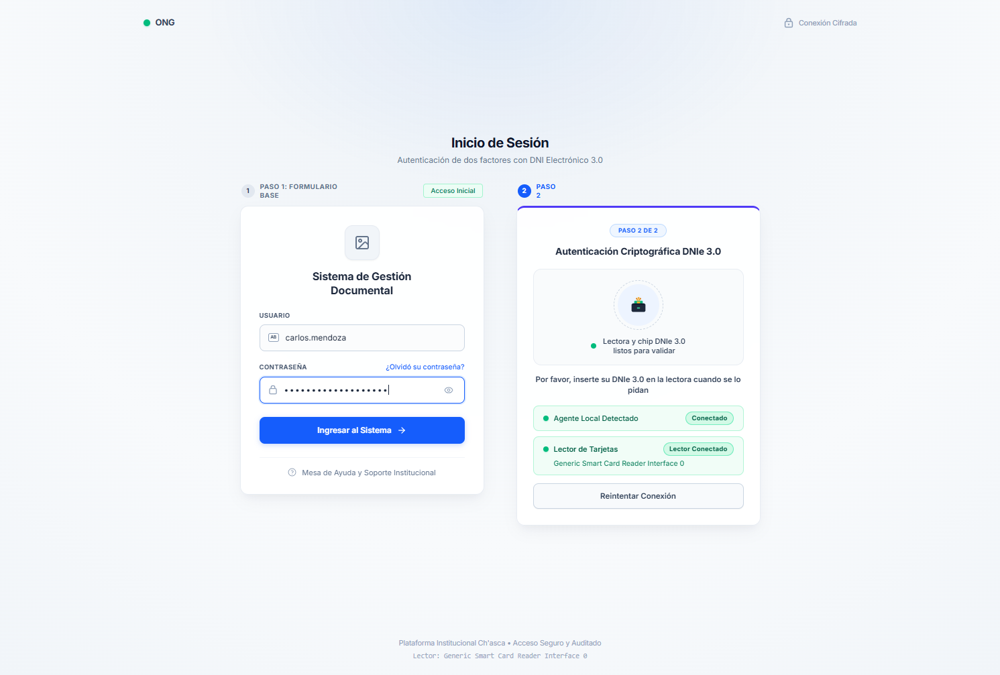

> *Captura opcional pendiente (`ui_hardware_lock_overlay.png`):* Si se requiere documentar el estado de bloqueo hardware en caliente (Kill-Switch 60s), retirar el DNIe físico de la lectora durante una sesión activa para capturar `HardwareLockOverlay` y guardarlo en `assets/ui_hardware_lock_overlay.png`.

---

### 5.2 Tablero Operativo y Centro de Políticas ABAC (`/dashboard` y `AuthorizationPolicyModal`)

- **Problema de Negocio:** Cada colaborador tiene capacidades distintas (crear borradores, revisar expedientes, firmar ejecutivamente o auditar) y un alcance restringido por área y clasificación de confidencialidad.
- **Componentes UI:** `AppShell`, `AppSidebar`, `AppToolbar`, `DashboardPage`, `AuthorizationPolicyModal`.
- **Flujo del Usuario:**
  1. `AppSidebar` y `DashboardPage` adaptan sus métricas, filtros y accesos rápidos según `useAuthorizationPolicy()` (`DOCUMENTS_SIGN`, `DOCUMENTS_REVIEW`, `DOCUMENTS_CREATE`, `AUDIT_READ`, `ACCOUNTS_CREATE`).
  2. El usuario puede filtrar documentos por estado (`DRAFT`, `IN_REVIEW`, `PENDING_SIGNATURE`, `SIGNED`), nivel de confidencialidad (`PUBLIC`, `INTERNAL`, `CONFIDENTIAL`, `RESTRICTED`), búsqueda global (`ShellProvider`) o vistas rápidas (`?vista=firmar`, `?vista=revisar`, `?vista=auditoria`).
  3. Desde `AppToolbar` o `AppSidebar`, puede abrir `AuthorizationPolicyModal` para auditar su propio `BusinessProfile`, sus niveles habilitados, qué niveles exigen Step-Up PIN y su alcance departamental.

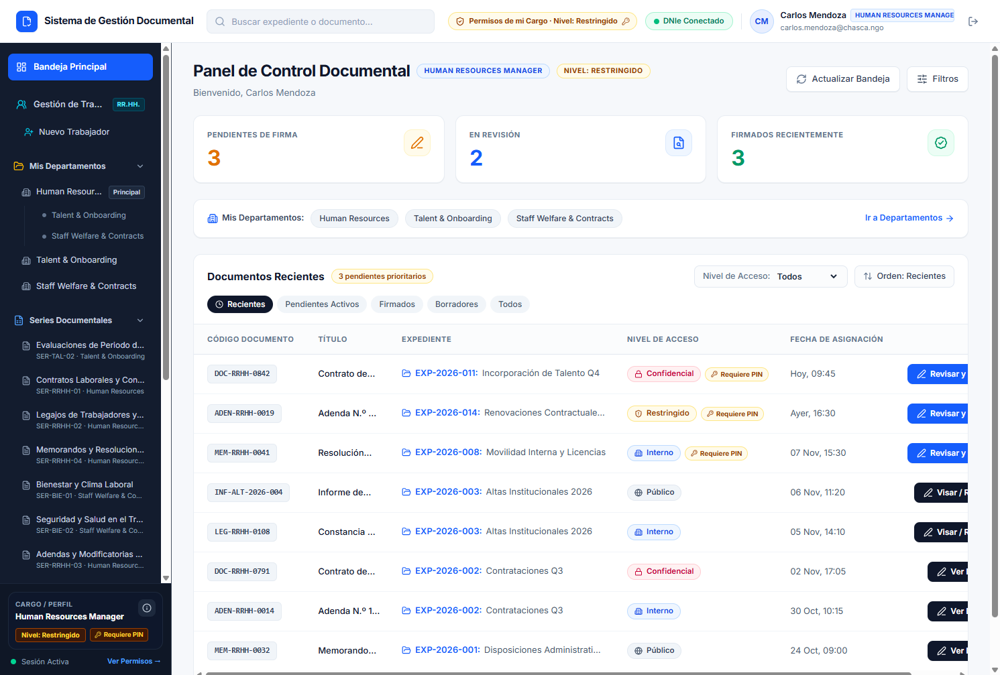

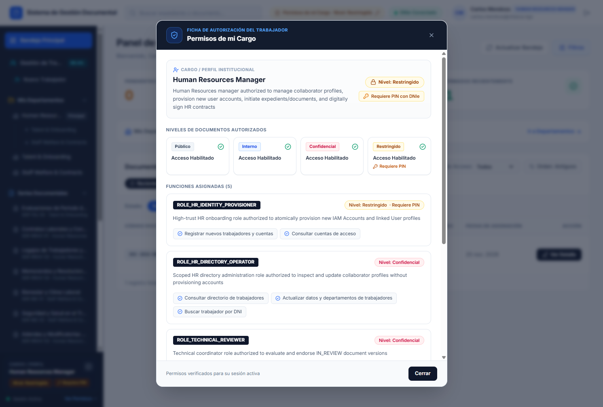

---

### 5.3 Gestión Organizacional, Series Documentales y Expedientes (`/departamentos`, `/series/:seriesId`, `/expedientes/:expedientId`)

- **Problema de Negocio:** Los documentos institucionales deben organizarse conforme a la taxonomía archivística ISO 15489-1 (Departamento $\rightarrow$ Serie Documental con años de retención $\rightarrow$ Expediente $\rightarrow$ Documento $\rightarrow$ Versión inmutable).
- **Componentes UI:** `DepartmentViewPage`, `DocumentSeriesDetailPage`, `ExpedientDetailPage`, `NewExpedientModal`, `UploadDocumentModal`.
- **Flujo del Usuario:**
  1. En `/departamentos` (o `/departamentos/:departmentId`), el usuario visualiza únicamente los departamentos autorizados por su perfil (`policy.canAccessDepartment(id)`). Dispone de tres pestañas: `SERIES`, `EXPEDIENTS` y `COLLABORATORS`.
  2. Al seleccionar una serie (`/series/:seriesId`), consulta su código, valor documental y años de retención; si cuenta con permisos (`documents:create|review|sign`), puede abrir `NewExpedientModal` filtrando niveles de confidencialidad permitidos por su política.
  3. Dentro de `/expedientes/:expedientId`, mientras el expediente esté `OPEN`, un usuario con `documents:create` abre `UploadDocumentModal` para cargar el PDF inicial (máximo `25 MB`), asociando metadatos ISO 23081 (`title`, `semanticSummary`, `legalMandate`, `businessActivity`, `confidentiality`).
  4. Revisores o firmantes pueden cerrar el expediente (`PATCH /api/v1/expedients/{expedientId}/close`), inmovilizándolo administrativamente.

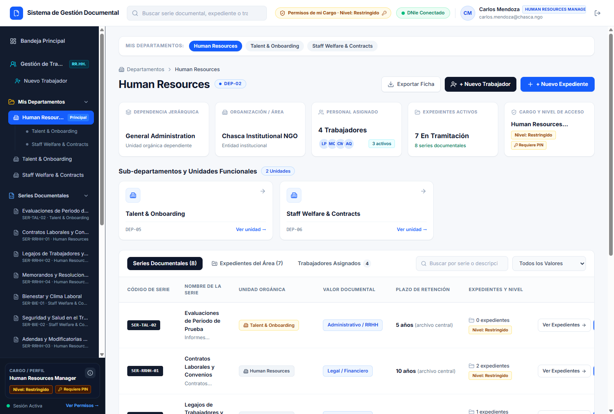

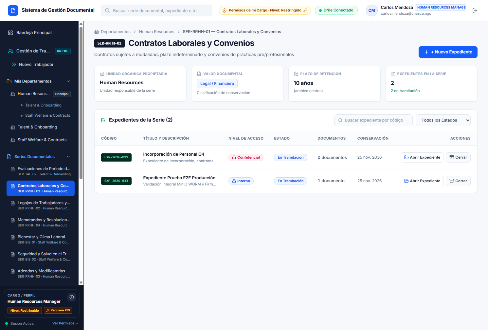

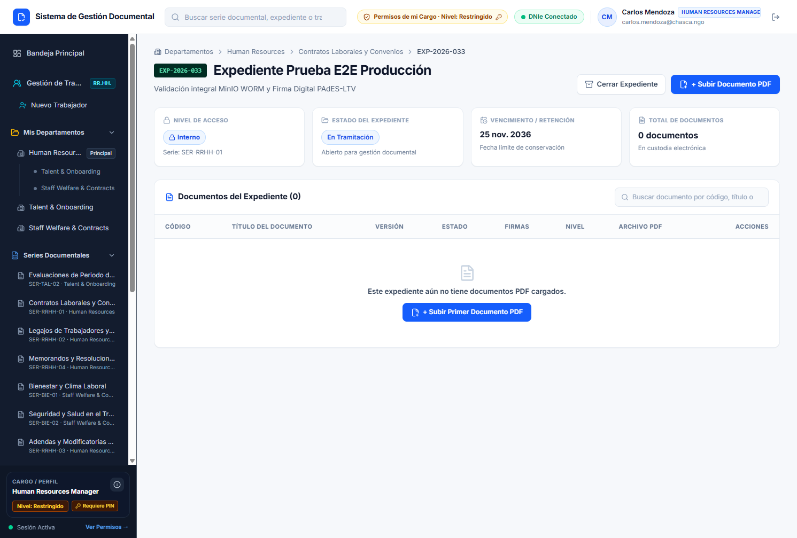

---

### 5.4 Visor Seguro, Verificación PKI y Firma Digital PAdES-LTV (`DocumentViewerModal`)

- **Problema de Negocio:** Garantizar que cualquier PDF consultado esté íntegro respecto a MinIO WORM, muestre marcas de agua dinámicas anti-fuga, permita asignar firmantes por rol o etiqueta `[[SIG:ROLE:DNI]]` y ejecute firmas digitales PAdES-LTV con sello de tiempo RFC 3161.
- **Componentes UI:** `DocumentViewerModal`, `DocumentPreviewModal`, `DocumentWatermarkOverlay`, `UploadDocumentModal`.
- **Flujo del Usuario:**
  1. Al hacer clic en un documento, `DocumentViewerModal` consulta `GET /viewer-summary` y descarga el binario PDF protegido enviando `X-Target-Sensitivity`.
  2. Si la clasificación exige Step-Up PIN (`428`), `apiClient` dispara la verificación con `KILLAgent` y reintenta transparentemente la descarga.
  3. El PDF se renderiza bajo `DocumentWatermarkOverlay` (marca de agua dinámica con usuario, DNI, fecha y nivel de confidencialidad).
  4. En el panel lateral de verificación PKI, el usuario visualiza:
     - **Slots de firma:** asignados automáticamente por anclas `[[SIG:ROLE:DNI]]` o creados manualmente (`POST /signature-slots` con `eligible-signers`).
     - **Integridad multicapa:** estado de `storageVsVersionLayer`, `versionVsSignatureLayer` y `auditTrailHmacLayer`, además de estado de `tsaStatus` (DigiCert / FreeTSA) y vigencia de certificados.
  5. Si el usuario es firmante elegible en un slot `PENDING`, pulsa **Firmar con DNIe**:
     - Backend prepara `/ByteRange` (`POST .../signatures/prepare`).
     - `KILLAgent` solicita el PIN en `AntiKeyloggerKeypadDialog` y firma con el certificado `nonRepudiation` (`SIGN_DOCUMENT_DIGEST`).
     - Backend estampa el CMS PAdES-LTV con TSA RFC 3161 (`POST .../signatures`) y sella la nueva versión en MinIO WORM.
  6. Un revisor/firmante puede también rechazar un slot (`POST .../signature-slots/{slotId}/reject`) devolviendo el documento a `IN_REVIEW`, o un creador autorizado puede subir una nueva versión si el documento no está `SIGNED`.

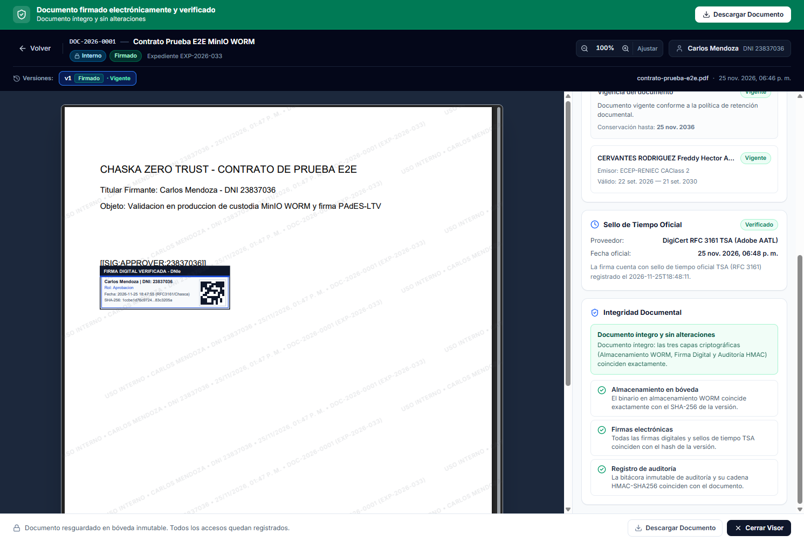

---

### 5.5 Gestión de Personal, Segregación de Funciones y Onboarding Temporal (`/personal`, `/personal/nuevo`, `/registro/:token`)

- **Problema de Negocio:** Evitar que administradores de RR. HH. asignen contraseñas iniciales por otros usuarios o se auto-asignen privilegios de infraestructura IT (`security:manage`).
- **Componentes UI:** `PersonnelManagementPage`, `CreateWorkerPage`, `CreateCollaboratorModal`, `ManageCollaboratorModal`, `OnboardingLinkResultBanner`, `OnboardingCompletionPage`.
- **Flujo del Usuario:**
  1. En `/personal`, el operador autorizado consulta el directorio (`DIRECTORY`), invitaciones activas (`INVITATIONS`) y catálogo de perfiles (`PROFILES_CATALOG`).
  2. Quien posee `accounts:create` (ej. `Human Resources Manager`) crea una invitación desde `CreateWorkerPage` (`/personal/nuevo`) o `CreateCollaboratorModal`: ingresa DNI de 8 dígitos, datos personales, departamento primario/secundarios y `BusinessProfile` (con previsualización de sus permisos ABAC).
  3. El backend genera un enlace efímero válido por **12 horas** (`/registro/:token`), mostrado en `OnboardingLinkResultBanner`.
  4. El nuevo colaborador abre `/registro/:token` (`OnboardingCompletionPage`), verifica sus datos precargados (`GET /onboarding-invitations/{token}`), define personalmente su `username` y `password` (`POST .../complete`) y queda habilitado para iniciar sesión en `/login` con su DNIe 3.0.
  5. Mediante `ManageCollaboratorModal`, operadores con `users:update` editan perfil y departamentos, mientras que solo `accounts:create | security:manage` modifican el `BusinessProfile` o activación/desactivación de la cuenta.

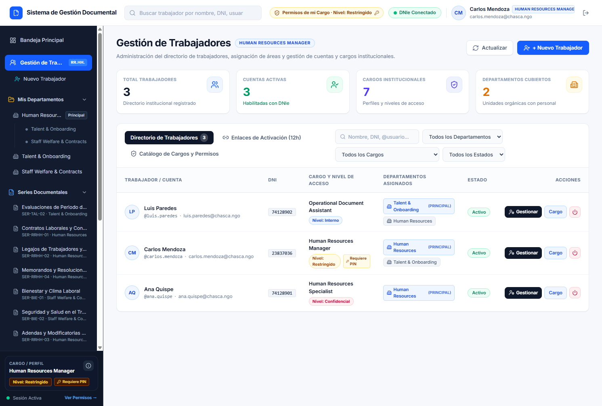

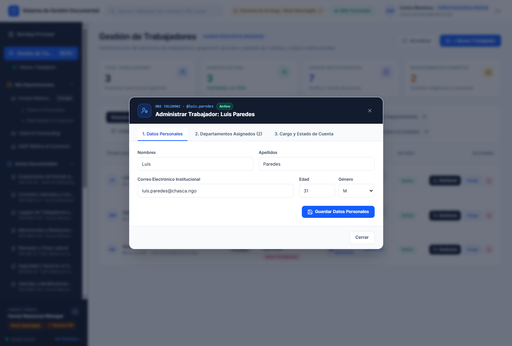

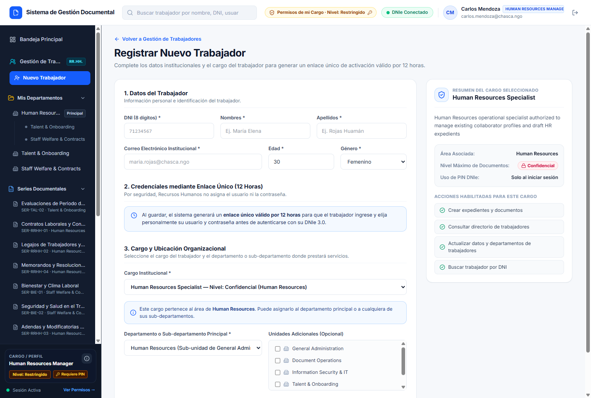

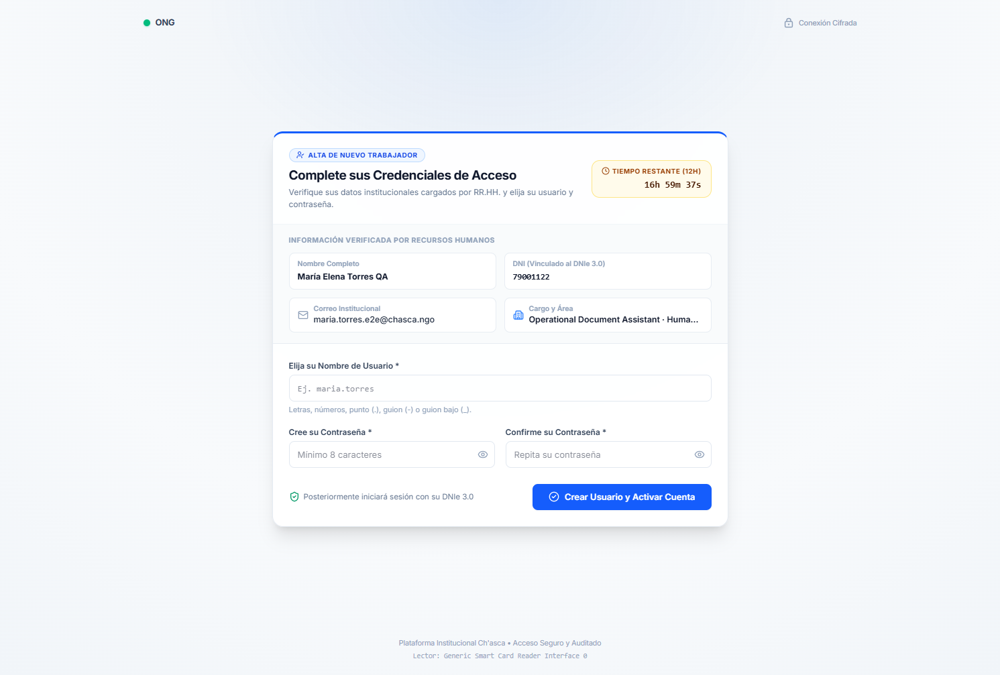

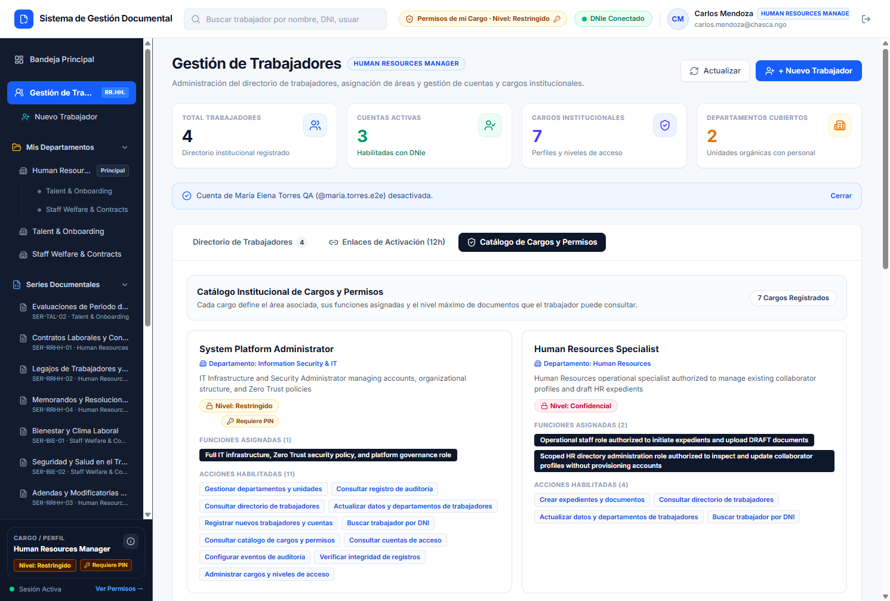

---

## 6. Arquitectura de Despliegue e Infraestructura

> **Fuente de Verdad:** Esta sección documenta la configuración real verificada mediante el **MCP oficial de Cloudflare** sobre la zona `chaska.lat` y los recursos reales en ejecución sobre **Coolify (`ChaskaVPS`)** al 2026-11-24.

### 6.1 Topología Real de Producción

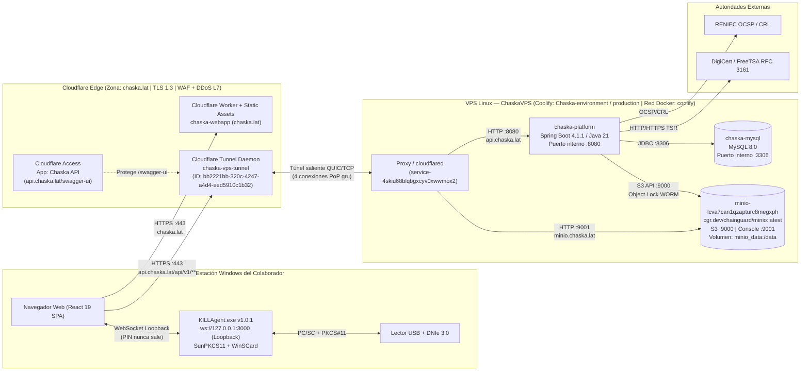

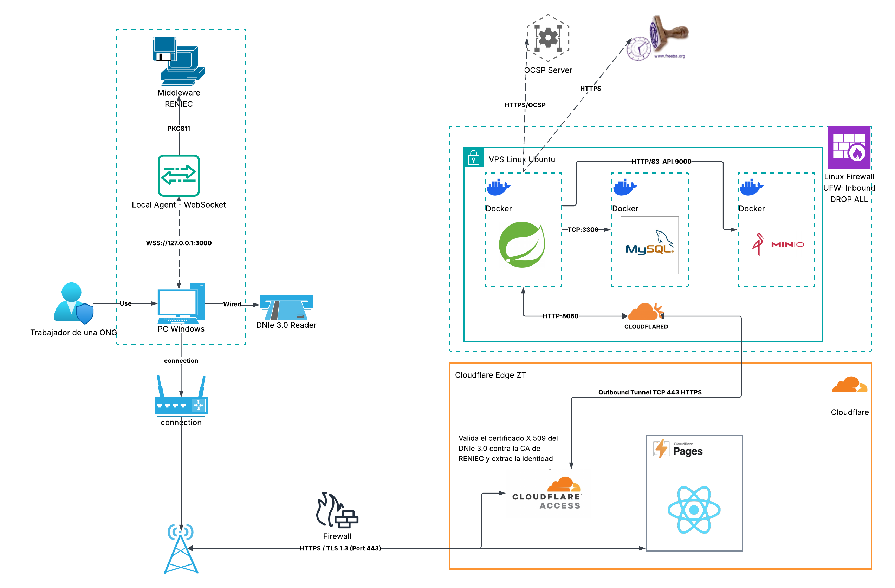

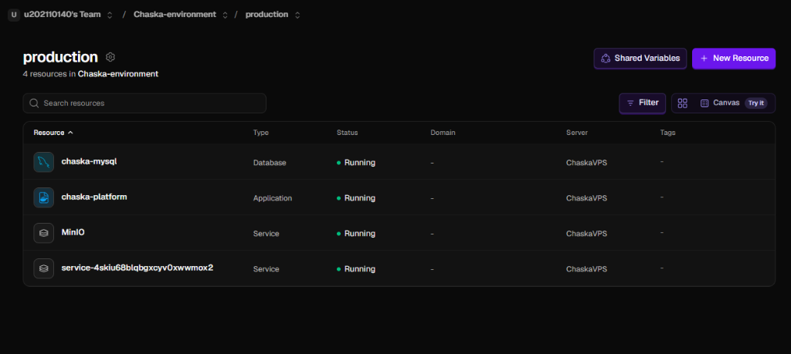

---

### 6.2 Configuración Real en Cloudflare (`chaska.lat`)

#### A. Zona DNS y Edge Security
- **Zona:** `chaska.lat` (`zone_id: 5424cce5e7f0e72bdb1126a692ef0259`, Plan *Free Website*).
- **Nameservers:** `priscilla.ns.cloudflare.com`, `yahir.ns.cloudflare.com`.
- **Seguridad TLS y Red:**
  - Modo SSL/TLS: `full`
  - Versión mínima TLS: **`1.3`** (`min_tls_version: 1.3`)
  - `always_use_https`: `on` | `automatic_https_rewrites`: `on`
- **Rulesets Gestionados Activos:** `Cloudflare Normalization Ruleset`, `Cloudflare Managed Free Ruleset` (WAF), `DDoS L7 ruleset`, `Cloudflare Managed Response Firewall Default`.
- **Cloudflare R2:** Deshabilitado en esta cuenta (toda la custodia de objetos PDF opera en MinIO dentro de `ChaskaVPS`).

#### B. Registros DNS Activos

| Tipo | Nombre | Contenido / Destino | Proxied | Propósito |
| :--- | :--- | :--- | :--- | :--- |
| `AAAA` | `chaska.lat` | `100::` | Sí | Dominio personalizado enlazado al Worker `chaska-webapp` |
| `CNAME` | `api.chaska.lat` | `bb2221bb-320c-4247-a4d4-eed5910c1b32.cfargotunnel.com` | Sí | API Spring Boot a través de `chaska-vps-tunnel` |
| `CNAME` | `minio.chaska.lat` | `bb2221bb-320c-4247-a4d4-eed5910c1b32.cfargotunnel.com` | Sí | Consola Web UI de MinIO (`:9001`) vía túnel |
| `CNAME` | `ssh.chaska.lat` | `0b664fda-28d3-4cb1-81f2-3911ffb04b74.cfargotunnel.com` | Sí | Acceso SSH administrativo gestionado por Coolify |

#### C. Frontend en Cloudflare Workers (`chaska-webapp`)
- **Worker ID:** `chaska-webapp` (`compatibility_date: 2026-01-01`, `has_assets: true`, `usage_model: standard`).
- **Configuración (`wrangler.jsonc`):** Sirve `./dist` con `"not_found_handling": "single-page-application"`, permitiendo recarga directa de rutas SPA como `/registro/:token` o `/expedientes/:id`.
- **Dominio Personalizado:** `https://chaska.lat` (Worker Domain activo con certificado gestionado).
- *(Nota: el repositorio también incluye `Dockerfile` + `nginx.conf` como alternativa de despliegue contenerizado en Coolify/Nginx si fuera necesario).*

#### D. Cloudflare Tunnels (`cloudflared` v2026.11.1) y Cloudflare Access
1. **Túnel Aplicativo `chaska-vps-tunnel`** (`id: bb2221bb-320c-4247-a4d4-eed5910c1b32`, estado `healthy`, 4 conexiones en PoP `gru11`/`gru20`/`gru21`/`gru22`):
   - `api.chaska.lat` $\rightarrow$ `http://chaska-backend:8080`
   - `minio.chaska.lat` $\rightarrow$ `http://minio-lcva7can1qzapturc8megxph:9001`
   - Catch-all $\rightarrow$ `http_status:404`
2. **Túnel Administrativo Coolify `coolify-wj4qofp8fq2cvijp6bcdcwgg`** (`id: 0b664fda-28d3-4cb1-81f2-3911ffb04b74`, estado `healthy`):
   - `ssh.chaska.lat` $\rightarrow$ `ssh://localhost:22`
   - Catch-all $\rightarrow$ `http_status:404`
3. **Cloudflare Access (`Chaska API`):**
   - Protege `api.chaska.lat/swagger-ui` (`type: self_hosted`, duración de sesión `30m`, CORS permitido desde `https://chaska.lat`).
   - Política `Acceso Autorizado` (`decision: allow`) restringida por identidad de correo corporativo autorizado.

---

### 6.3 Servicios en Coolify (`ChaskaVPS` — `Chaska-environment / production`)

En el servidor `ChaskaVPS` bajo Coolify corren exclusivamente **4 recursos** en estado `Running` sobre la red Docker externa `coolify`:

| Recurso en Coolify | Tipo | Rol en Producción | Puertos / Red Interna |
| :--- | :--- | :--- | :--- |
| `chaska-mysql` | Database | Base de datos relacional MySQL 8.0 (`chaskaDB`) | `3306` (red `coolify`, sin exposición pública) |
| `chaska-platform` | Application | API Spring Boot construida desde `Chaska/Dockerfile` (JRE 21 + `fontconfig` + `fonts-dejavu-core` para PDFBox, usuario no-root `chaska:1001`, healthcheck `/api/v1/health`) | `8080` (expuesta únicamente vía túnel) |
| `MinIO` | Service | Custodia documental S3 (`cgr.dev/chainguard/minio:latest`; hostname real en red `coolify`: `minio-lcva7can1qzapturc8megxph`, `container_name` declarado en compose: `chaska-minio`) | `:9000` (API S3) y `:9001` (Consola Web) |
| `service-4skiu68blqbgxcyv0xwwmox2` | Service | Servicio proxy / conector `cloudflared` enlazado a la red `coolify` | Saliente TCP/QUIC hacia Cloudflare Edge |

#### Docker Compose Real de MinIO en Producción (Coolify)

```yaml
services:
  minio:
    image: cgr.dev/chainguard/minio:latest
    container_name: chaska-minio
    user: "0:0"
    restart: unless-stopped
    command: server /data --console-address ":9001"
    environment:
      MINIO_ROOT_USER: ${MINIO_ROOT_USER}
      MINIO_ROOT_PASSWORD: ${MINIO_ROOT_PASSWORD}
    volumes:
      - minio_data:/data
    networks:
      - coolify

volumes:
  minio_data:

networks:
  coolify:
    external: true
```

> **Nota sobre Resolución DNS Interna en Coolify:** Aunque el Compose declara `container_name: chaska-minio`, Coolify gestiona el identificador del servicio en la red `coolify` como **`minio-lcva7can1qzapturc8megxph`** (coincidiendo con el target `http://minio-lcva7can1qzapturc8megxph:9001` del túnel `chaska-vps-tunnel`). El endpoint S3 interno para el backend es **`http://minio-lcva7can1qzapturc8megxph:9000`**.

---

### 6.4 Configuración Operativa de MinIO WORM y Hardening en Producción

1. **Estado del Bucket WORM (`chasca-document-bucket`):**
   - El bucket **`chasca-document-bucket`** ya se encuentra creado y validado con **Object Lock (`--with-lock`) y Versioning habilitados** (`versioning is enabled`), listo para recibir objetos con retención `COMPLIANCE` y *Legal Hold* desde `chaska-platform`.
   - En `application.properties`, mantener `STORAGE_MINIO_AUTO_CREATE_BUCKET=false` en producción para impedir que el sistema cree accidentalmente buckets sin bloqueo WORM ante errores de nombre.
2. **Limitación de la Consola Web y Herramienta CLI Oficial (`cgr.dev/chainguard/minio-client`):**
   - En las versiones recientes de **MinIO Community Edition** (`cgr.dev/chainguard/minio:latest`), la Consola Web (`https://minio.chaska.lat`) opera únicamente como *Object Browser* (no expone pantallas de configuración de Object Lock, Versioning ni gestión IAM de usuarios/políticas).
   - Adicionalmente, las imágenes `minio/minio` y `minio/mc` fueron retiradas de Docker Hub. Toda administración S3/IAM debe ejecutarse mediante **`cgr.dev/chainguard/minio-client:latest`** (imagen *distroless* sin `sh`, ejecutada bajo UID `65532`) pasando las credenciales por la variable `MC_HOST_prod`:
     ```bash
     # Verificar hostname real en caso de recreación del servicio en Coolify
     sudo docker ps --filter "name=minio" --format "Contenedor: {{.Names}} | Redes: {{.Networks}}"

     # Consultar estado de versionado / Object Lock (codificar caracteres especiales en URL si aplica)
     export MC_HOST_URL="http://<MINIO_ROOT_USER>:<MINIO_ROOT_PASSWORD>@minio-lcva7can1qzapturc8megxph:9000"
     sudo docker run --rm --network coolify -e MC_HOST_prod="$MC_HOST_URL" \
       cgr.dev/chainguard/minio-client:latest version info prod/chasca-document-bucket
     unset MC_HOST_URL
     ```
3. **Política IAM de Mínimo Privilegio y Usuario Dedicado (`chaska-backend-svc`):**
   - El backend **no debe operar en producción con `MINIO_ROOT_USER`**. Según las operaciones reales de `MinioS3DocumentStorageAdapter.java`, la cuenta de servicio **`chaska-backend-svc`** requiere únicamente la política **`chaska-backend-worm`** (sin `s3:DeleteObject`, `s3:DeleteBucket` ni `s3:BypassGovernanceRetention`):
     ```json
     {
       "Version": "2012-10-17",
       "Statement": [
         {
           "Effect": "Allow",
           "Action": [
             "s3:ListBucket",
             "s3:GetBucketVersioning",
             "s3:GetBucketObjectLockConfiguration"
           ],
           "Resource": ["arn:aws:s3:::chasca-document-bucket"]
         },
         {
           "Effect": "Allow",
           "Action": [
             "s3:PutObject",
             "s3:GetObject",
             "s3:GetObjectVersion",
             "s3:PutObjectRetention",
             "s3:GetObjectRetention",
             "s3:PutObjectLegalHold",
             "s3:GetObjectLegalHold"
           ],
           "Resource": ["arn:aws:s3:::chasca-document-bucket/*"]
         }
       ]
     }
     ```
   - **Aprovisionamiento / Rotación por CLI (permisos `644` para lectura del UID `65532`):**
     ```bash
     chmod 644 /tmp/chaska-backend-policy.json
     export MC_HOST_URL="http://<MINIO_ROOT_USER>:<MINIO_ROOT_PASSWORD>@minio-lcva7can1qzapturc8megxph:9000"

     sudo docker run --rm --network coolify -e MC_HOST_prod="$MC_HOST_URL" \
       -v /tmp/chaska-backend-policy.json:/tmp/policy.json:ro \
       cgr.dev/chainguard/minio-client:latest admin policy create prod chaska-backend-worm /tmp/policy.json

     sudo docker run --rm --network coolify -e MC_HOST_prod="$MC_HOST_URL" \
       cgr.dev/chainguard/minio-client:latest admin user add prod chaska-backend-svc "<MINIO_SERVICE_SECRET>"

     sudo docker run --rm --network coolify -e MC_HOST_prod="$MC_HOST_URL" \
       cgr.dev/chainguard/minio-client:latest admin policy attach prod chaska-backend-worm --user chaska-backend-svc

     rm -f /tmp/chaska-backend-policy.json
     unset MC_HOST_URL
     ```
4. **Hardening de Exposición de Consola (`minio.chaska.lat`):**
   - El túnel `chaska-vps-tunnel` expone la Consola Web `:9001` en `https://minio.chaska.lat` (`http://minio-lcva7can1qzapturc8megxph:9001`). Se recomienda proteger `minio.chaska.lat` mediante una aplicación **Cloudflare Access** (aplicando la política `Acceso Autorizado`) o deshabilitar el *Public Hostname* en el túnel cuando no se realicen tareas administrativas.
   - Tras configurar las variables en `chaska-platform`, validar conectividad S3 y bloqueo WORM ejecutando `GET https://api.chaska.lat/api/v1/documents/storage/health` (`bucketExists: true`, `objectLockEnabled: true`, `versioningEnabled: true`).

---

### 6.5 Variables de Entorno por Componente (Valores Sensibles Sanitizados)

#### A. Backend (`Chaska` — `application.properties` / Coolify)

| Variable | Valor / Formato en Producción | Propósito |
| :--- | :--- | :--- |
| `SERVER_PORT` | `8080` | Puerto HTTP del contenedor |
| `DB_URL` | `jdbc:mysql://chaska-mysql:3306/chaskaDB?useSSL=false&allowPublicKeyRetrieval=true` | Conexión interna a MySQL 8 |
| `DB_USERNAME` / `DB_PASSWORD` | `<SECRET_MYSQL_USER>` / `<SECRET_MYSQL_PASSWORD>` | Credenciales de base de datos |
| `SECURITY_JWT_SECRET` | `<SECRET_HMAC_256_MIN_32_CHARS>` | Firma HMAC-SHA256 de JWT |
| `SECURITY_JWT_EXPIRATION_SECONDS` | `1800` | TTL del JWT (30 min) |
| `SECURITY_AUDIT_HMAC_SECRET` | `<SECRET_AUDIT_HMAC>` | Sellado de cadena `ImmutableAuditLog` |
| `SECURITY_AUDIT_ANCHOR_PATH` | `/app/.context/audit-anchors/latest-audit-anchor.json` | Ancla externa forense |
| `CORS_ALLOWED_ORIGINS` | `https://chaska.lat,https://*.chaska.lat` | Orígenes permitidos por CORS |
| `STORAGE_MINIO_ENABLED` | `true` | Activa `MinioS3DocumentStorageAdapter` |
| `STORAGE_MINIO_ENDPOINT` | `http://minio-lcva7can1qzapturc8megxph:9000` | Endpoint interno S3 en red `coolify` |
| `STORAGE_MINIO_ACCESS_KEY` / `SECRET_KEY` | `chaska-backend-svc` / `<MINIO_SERVICE_SECRET>` | Credenciales S3 de mínimo privilegio |
| `STORAGE_MINIO_BUCKET` | `chasca-document-bucket` | Bucket WORM |
| `STORAGE_MINIO_AUTO_CREATE_BUCKET` | `false` | Impide creación accidental sin `--with-lock` |
| `STORAGE_MINIO_RETENTION_MODE` | `COMPLIANCE` | Modo estricto WORM ISO 15489-1 |
| `SIGNATURE_TSA_ENABLED` / `URL` / `FALLBACK_URL` | `true` / `http://timestamp.digicert.com` / `https://freetsa.org/tsr` | Sello de tiempo RFC 3161 |

#### B. Frontend (`chaska-webapp`)

| Variable | Producción (`chaska.lat`) | Desarrollo Local |
| :--- | :--- | :--- |
| `VITE_API_BASE_URL` | `https://api.chaska.lat` | *(vacío; usa proxy Vite `/api` $\rightarrow$ `localhost:8080`)* |
| `VITE_KILL_AGENT_WS_URL` | *(opcional; default `ws://127.0.0.1:3000` con fallback `wss://`)* | `ws://127.0.0.1:3000` |

#### C. Agente Local (`KILLAgent` — `%LOCALAPPDATA%\Chaska\KILLAgent\.env` o `config.properties`)

| Variable | Valor de Producción | Propósito |
| :--- | :--- | :--- |
| `ENVIRONMENT` | `production` | Bloquea comodines `*` en `ALLOWED_ORIGINS` |
| `KILLAGENT_HOST` / `KILLAGENT_PORT` | `127.0.0.1` / `3000` | Loopback obligatorio |
| `KILLAGENT_SECURE_WSS` | `false` (o `true` con `loopback.p12`) | Protocolo WS/WSS local |
| `ALLOWED_ORIGINS` | `https://chaska.lat,https://*.chaska.lat,...` | Allowlist Anti-CSWSH |
| `RENIEC_PKCS11_DLL_PATH_DNI3` | `C:\Program Files\IDEMIA\IDPlugClassic\DLLs\idplug-pkcs11.dll` | Middleware DNIe 3.0 |
| `RENIEC_PKCS11_DLL_PATH_DNI2` | `C:\Windows\System32\bit4ipki.dll` | Middleware DNIe 2.0 |
| `DOCUMENT_DIGEST_SIGN_MODE` | `PADES_DIGEST_INFO` | Framing DER DigestInfo para `NONEwithRSA` |
| `UPDATE_MANIFEST_URL` / `UPDATE_SIGNING_PUBLIC_KEY` | GitHub Releases `update-manifest.json` + SPKI Ed25519 | Auto-actualización verificada |

---

### 6.6 Pipelines CI/CD y Distribución Desktop

- **`Chaska` (`.github/workflows/ci.yml`):** En cada push/PR a `main`, ejecuta `./mvnw -B clean verify` sobre Ubuntu + JDK 21 Temurin y sube reportes Surefire ante fallo.
- **`chaska-webapp` (`.github/workflows/ci.yml`):** Ejecuta build TypeScript + Vite y `eslint` en Node.js. Despliegue a Cloudflare Workers vía `wrangler deploy`.
- **`Killa` (`.github/workflows/release.yml`):** En tags `v*.*.*` o `workflow_dispatch` sobre `windows-latest`, ejecuta `mvn -B clean test`, empaqueta con `jlink` + `jpackage` (`package-windows.ps1`) generando instalador `.msi` (WiX Toolset v3), `.zip` portable, `SHA256SUMS.txt` y `update-manifest.json` firmado con clave privada **Ed25519** (`scripts/ManifestSigner.java`), realiza smoke test (`KILLAgent.exe --version`) y publica en GitHub Releases.

---

## 7. Plan de Mantenimiento (Basado en ISO/IEC 14764)

Esta estrategia formal de mantenimiento sigue la clasificación normativa **ISO/IEC 14764** (*Software Engineering — Software Life Cycle Processes — Maintenance*), adaptada a la arquitectura Zero Trust distribuida de **Ch'asca** (Backend Coolify/MySQL/MinIO, Edge Cloudflare y Agente Desktop `KILLAgent`).

| Tipo ISO/IEC 14764 | Propósito Principal | Disparador | Ejemplos Clave en Ch'asca |
| :--- | :--- | :--- | :--- |
| **Correctivo** | Diagnosticar y corregir fallos tras despliegue | Incidentes, errores HTTP `5xx`/`401`/`428`, fallos PKCS#11 | Caída de túnel, error `Object Lock` en MinIO, rechazo `ORIGIN` `1008`, `CKR_PIN_*` |
| **Adaptativo** | Mantener compatibilidad ante cambios del entorno | Updates de Java/Spring/Node, cambios RENIEC/Windows/Cloudflare | Nuevos drivers IDEMIA/Bit4id, cambios en APIs WinSCard, actualización TSA/OCSP |
| **Perfectivo** | Mejorar rendimiento, escalabilidad y UX | Métricas de latencia, crecimiento de PDFs o tablas | Flyway, caché distribuida Redis para sesiones hardware, streaming PDF, code-splitting |
| **Preventivo** | Detectar y mitigar riesgos latentes y deuda técnica | Auditorías programadas, rotación de secretos, alertas tempranas | Cron HMAC/WORM, backups 3-2-1, rotación JWT/HMAC/Ed25519, cobertura de pruebas |

---

### 7.1 Mantenimiento Correctivo

#### A. Matriz de Severidad y SLAs de Respuesta

| Severidad | Definición Operativa | Tiempo Respuesta (Ack) | Tiempo Resolución Objetivo |
| :--- | :--- | :--- | :--- |
| **P1 — Crítica** | Plataforma inaccesible (`chaska.lat` o `api.chaska.lat` caídos), falla de integridad HMAC (`isTampered=true`), MinIO inaccesible o bloqueo masivo de firmas. | `15 min` | `2 horas` |
| **P2 — Alta** | Degradación de un módulo (ej. fallo de TSA RFC 3161 primario, errores en estaciones Windows concretas con `KILLAgent`, fallo de onboarding). | `30 min` | `8 horas` |
| **P3 — Media** | Incidencia funcional con *workaround* disponible o afectación a un único usuario/expediente. | `4 horas` | `2 días hábiles` |
| **P4 — Baja** | Defectos visuales menores, mensajes de UI o mejoras no bloqueantes. | `1 día hábil` | Próximo sprint |

#### B. Protocolo de Triaje y Correlación de Logs en 3 Capas
1. **Capa Frontend (`chaska-webapp`):** Inspeccionar DevTools (`Network` y `Console`). Capturar la cabecera de respuesta **`X-Correlation-Id`** y el cuerpo `ErrorResponseResource` (`status`, `userMessage`, `timestamp`, `details`).
2. **Capa Edge (`Cloudflare`):** Verificar estado de los 2 túneles (`chaska-vps-tunnel` y `coolify-wj4qofp8fq2cvijp6bcdcwgg`), logs WAF/Firewall y eventos de Cloudflare Access (`/swagger-ui`).
3. **Capa Backend (`chaska-platform` en Coolify):** Filtrar logs del contenedor por el `correlationId` registrado en MDC (`ZeroTrustSecurityFilter`) y consultar `GET /api/v1/audit-logs` o la tabla `immutable_audit_logs` por `correlation_id`.
4. **Capa Estación (`KILLAgent`):** Abrir el **Panel de Diagnóstico** desde el ícono de bandeja de Windows o revisar `%LOCALAPPDATA%\Chaska\KILLAgent\logs\killagent.log` (y `killagent.log.1`, rotación cada `5 MiB`).

#### C. Runbooks de Resolución Rápida

| Síntoma | Causa Probable | Acción Correctiva Inmediata |
| :--- | :--- | :--- |
| `503` al subir PDF: *"El bucket de MinIO no tiene Object Lock habilitado"* | Bucket creado sin `--with-lock` o inexistente (`AUTO_CREATE_BUCKET=false`). | Verificar con `cgr.dev/chainguard/minio-client:latest` (`mc version info`); si no tiene Object Lock, crear bucket nuevo con `mc mb --with-lock` (Sección 6.4) y actualizar `STORAGE_MINIO_BUCKET`. |
| WebSocket `1008` al abrir `chaska.lat` | El dominio activo no figura en `ALLOWED_ORIGINS` de `KILLAgent`. | Agregar el origen HTTPS exacto en `%LOCALAPPDATA%\Chaska\KILLAgent\.env` (`ALLOWED_ORIGINS`) y reiniciar `KILLAgent` desde la bandeja. |
| `401` repentino durante sesión activa con DNIe puesto | Timeout de heartbeat `> 120s` (suspensión de PC / pérdida de red) o `CARD_REMOVED` fugaz. | Verificar `GET /api/v1/hardware-token-sessions/by-account/{id}` y estabilidad del lector USB; re-autenticar en `/login`. |
| `PKCS11_ERROR` al firmar en estación nueva | Middleware RENIEC (`idplug-pkcs11.dll` o `bit4ipki.dll`) no instalado o ruta distinta. | Validar ruta en Panel de Diagnóstico de `KILLAgent` y ajustar `RENIEC_PKCS11_DLL_PATH_DNI3` / `DNI2`. |
| TSA primaria DigiCert falla (`TsaStatus != VERIFIED`) | Bloqueo de red saliente TCP 80/443 o caída temporal de `timestamp.digicert.com`. | Confirmar fallback automático hacia `SIGNATURE_TSA_FALLBACK_URL` (`https://freetsa.org/tsr`) y conectividad saliente del contenedor `chaska-platform`. |

---

### 7.2 Mantenimiento Adaptativo

1. **Middleware y Certificados RENIEC (Perú):**
   - Monitorear actualizaciones del software oficial de **IDEMIA IDPlugClassic** (DNIe 3.0) y **Bit4id** (DNIe 2.0), así como rotaciones de certificados raíz/intermedios o cambios de URL en respondedores **OCSP/CRL de RENIEC**.
   - Probar en ambiente de preproducción cada nueva DLL PKCS#11 verificando tanto `CertificatePurpose.AUTHENTICATION` (`digitalSignature`) como `CertificatePurpose.SIGNATURE` (`nonRepudiation`) en `Pkcs11Bridge` sin consumir reintentos PIN extra.
2. **Sistema Operativo Windows y Subsistema PC/SC:**
   - Ante actualizaciones mayores de Windows 11, validar el funcionamiento de `WinSCardReaderProbe` (JNA `Winscard.dll`), la persistencia de `SetWindowDisplayAffinity(WDA_EXCLUDEFROMCAPTURE)` en `AntiKeyloggerKeypadDialog` y las reglas de firma digital Authenticode del instalador `.msi`.
3. **Dependencias de Runtime y Plataformas Gestionadas:**
   - **Backend (`Chaska`):** Seguir parches LTS de Java 21 (`eclipse-temurin:21-jre-jammy`), Spring Boot `4.1.x`, `io.minio:minio`, `org.apache.pdfbox` y `bcpkix-jdk18on` ante CVE publicados en Dependabot/Maven Central.
   - **Frontend (`chaska-webapp`):** Actualizar `react`, `vite`, `@tanstack/react-query` y `axios`, ejecutando siempre `npm run build && npm run lint` y pruebas de regresión sobre el proxy/Cloudflare Worker (`wrangler.jsonc`).
   - **Infraestructura:** Actualizar periódicamente la imagen `cgr.dev/chainguard/minio:latest` y el daemon `cloudflared` (actualmente `2026.11.1`) manteniendo compatibilidad con TLS 1.3 y HTTP/2/QUIC.

---

### 7.3 Mantenimiento Perfectivo

1. **Base de Datos y Migraciones Versionadas:**
   - Actualmente `application.properties` opera con `spring.jpa.hibernate.ddl-auto=update`. Como evolución prioritaria hacia operación madura, introducir **Flyway** (`ddl-auto=validate`) para versionar cambios de esquema en `chaskaDB` sin riesgo en producción e indexar consultas frecuentes de `immutable_audit_logs` (`actor_id`, `resource_id`, `event_type_id`, `event_timestamp`).
2. **Escalabilidad Horizontal del Backend:**
   - El worker `JvmAuditQueueWorker`, `AUDIT_CHAIN_LOCK` y el mapa en memoria `preparedSignatures` de `SignatureSlotCommandServiceImpl` asumen una **única réplica** de `chaska-platform`. Para escalar a múltiples instancias tras un balanceador, externalizar `preparedSignatures` a **Redis** y migrar la cola de auditoría a un tópico particionado (Kafka/RabbitMQ) o bloqueo distribuido para preservar la cadena secuencial `HMAC-SHA256`.
3. **Rendimiento de Transferencia PDF y Bundle Frontend:**
   - Implementar streaming por chunks (`StreamingResponseBody`) en `GET /api/v1/documents/{id}/versions/{verId}/content` para reducir presión de heap en JVM cuando concurran descargas de expedientes cercanos al límite de `25 MB`.
   - En `chaska-webapp`, aplicar `React.lazy()` / *route-based code splitting* sobre `DocumentViewerModal` y vistas administrativas (`/personal`) para reducir el tamaño del bundle inicial servido por Cloudflare Workers.
4. **Limpieza de Código Demostrativo:**
   - A medida que todos los flujos documentales estén 100% respaldados por datos reales en MySQL/MinIO, retirar o aislar bajo flag de desarrollo `documentManagementMockService.ts`.

---

### 7.4 Mantenimiento Preventivo

#### A. Calendario Operativo de Verificación y Rotación

| Frecuencia | Tarea Preventiva | Responsable / Mecanismo |
| :--- | :--- | :--- |
| **Diario (02:00 AM)** | Verificación automática completa de cadena HMAC en `immutable_audit_logs` y actualización de `latest-audit-anchor.json`. | `@Scheduled` en `IntegrityVerificationServiceImpl` (`security.audit.integrity-cron`) |
| **Diario** | Backup automatizado cifrado de MySQL (`mysqldump --single-transaction`) y replicación/snapshot del volumen `minio_data` siguiendo regla **3-2-1** (3 copias, 2 medios, 1 fuera del VPS). | Cron en `ChaskaVPS` + almacenamiento externo cifrado |
| **Semanal** | Revisión de alertas de auditoría (`INTEGRITY_TAMPERING_DETECTED`, `ACCESS_DENIED_ABAC`, `STEP_UP_PIN_REQUIRED`) y salud de `GET /api/v1/documents/storage/health`. | Oficial de Cumplimiento (`AUDITOR`) / SRE |
| **Mensual** | Ejecución de pruebas de regresión completas en los 3 repositorios (`.\mvnw.cmd test`, `mvn test`, `npm run build && npm run lint`) y prueba de restauración de backup en staging. | Equipo de Ingeniería |
| **Trimestral / Semestral** | Rotación de `SECURITY_JWT_SECRET` (en ventana de mantenimiento), revisión de políticas de Cloudflare Access y verificación de expiración de certificados TSA/RENIEC/Ed25519 (`UPDATE_SIGNING_PUBLIC_KEY`). | Administrador de Seguridad (`ADMINISTRATOR`) |

> **Advertencia sobre Rotación de `SECURITY_AUDIT_HMAC_SECRET`:** Nunca sobrescribir `SECURITY_AUDIT_HMAC_SECRET` sin antes ejecutar `POST /api/v1/audit-logs/verifications`, archivar el ancla criptográfica firmada (`latest-audit-anchor.json`) y registrar un evento de corte/re-anclaje, ya que la verificación batch recalcula todas las filas históricas contra el secreto activo.

#### B. Monitoreo Proactivo Recomendado
- **Disponibilidad Edge & Origin:** Configurar *Health Checks* en Cloudflare o Uptime Kuma sobre `https://chaska.lat` y `https://api.chaska.lat/api/v1/health` (HTTP `200`, `"status": "UP"`), más alertas si el túnel `chaska-vps-tunnel` pierde sus conexiones activas (`status != healthy`).
- **Capacidad de Disco en `ChaskaVPS`:** Alertar cuando el volumen `minio_data` alcance el `75%` y `85%` de ocupación (recordar que en modo `COMPLIANCE` los objetos no pueden eliminarse antes de su `retainUntilDate`).
- **Distribución Segura de `KILLAgent`:** Mantener habilitado `UPDATE_AUTO_CHECK_ENABLED=true` con firma Ed25519 obligatoria (`UPDATE_SIGNING_PUBLIC_KEY`) y monitorear el canal `stable` en GitHub Releases para desplegar parches preventivos a todas las estaciones Windows sin intervención manual.
